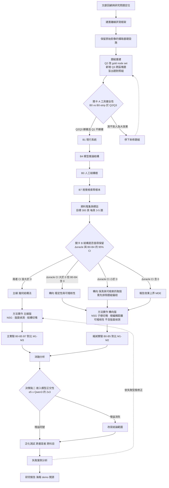

# 研究流程修改建議 v2

> 前置：`研究流程_修改--1.md`（建議 v1）、`研究流程_修改--1_審查回覆.md`（實測審查）。
> **本文件不取代 v1，也不取代審查回覆。** 三份並存：v1 是提案，審查是實測反駁，v2 是收斂後該執行的版本。
> 依據：審查提供的實測數字（未重跑，暫予採信），以及 `probes.md` / `hand_off.md` 原文。
>
> 體例：先認錯，再指出審查本身需要修正的地方，再處理雙方都漏掉的根本問題。

---

## 零、判定總表

### 我錯的（六項，全部採納審查的改法）

| # | 我的錯誤 | 性質 |
|---|---|---|
| 1 | 把 nDCG@10 與 MRR@10 並列為兩個主指標 | **代數錯誤**。單一 gold ＋ 二元相關度下，兩者都是 rank 的單調函數，逐題差值必定同號 |
| 2 | 寫「修正後 27 題」 | **粗心**。A 方案（改關鍵詞）題數維持 29，只有 B 方案才是 27。我把兩案的結果混在一起 |
| 3 | 決策門檻用比值 `R` | **統計錯誤，且後果嚴重**。分母 CI 跨 0 的比值不可估計；分子分母同負時 R 仍為正，會在「結構有害」的情況下授權開發 |
| 4 | B3 直接沿用 RSC 的 1,500 字元門檻 | **常數搬用錯誤**。e5-base 上限 512 token，中文約 1 字元 1 token，會被靜默截斷。這正是我自己在 v1 裡警告過的那類錯誤 |
| 5 | 流程圖 F1、F2 都連到含「版面偵測」的 G1 | **邏輯錯誤**。決策點沒有後果。我照抄 `hand_off.md` 的原圖而沒有檢查 |
| 6 | 逃生出口的時序 | **矛盾**。「擴到 100 頁再重跑」要第 10 週才有資料，但它要 gate 的方法實作第 7 週就開始 |

### 審查需要修正的（三項）

| # | 審查的說法 | 應改為 |
|---|---|---|
| A | `B0 − B1 = −0.131` 是「本專案唯一達到顯著的比較」 | **未經多重比較校正。** 依 `hand_off.md` 自訂的 Holm–Bonferroni 標準，此比較不成立 |
| B | 「保真度與可檢索性相互衝突」是實測發現 | **可能是題組來源造成的假象。** 在排除「關鍵詞取自 B1 輸出」之前，不能當成研究發現 |
| C | 200–300 頁「也許能產生 150–300 題」 | **低估約四倍。** `hand_off.md` 訂的是每頁 3–5 題，300 頁即 900–1,500 題——正好是審查自己算出的所需題數 |

### 雙方都沒說到的（一項，但它是根因）

> **現有 29 題全部都是單一 span 的 gold，包含那 10 題標為 `hierarchy` 的題目。**
> 這種計分方式**在結構上無法區分「只找到子節點」與「找到子節點＋其祖先標題」**。
> 所以 H2（機制假設）目前完全沒有被檢定，天花板效應也不是資料太少造成的——是題組測的東西根本不是結構。

這一節在第參節展開，它決定了關卡實驗該怎麼重新設計。

---

## 壹、我確認錯誤的六項

### 1. 主指標

審查的代數是對的。單一 gold、二元相關度下：

$$\text{nDCG@10}=\frac{1}{\log_2(\text{rank}+1)},\qquad \text{MRR@10}=\frac{1}{\text{rank}}$$

兩者都是 rank 的單調遞減函數，逐題差值必定同號。實測 0/87 不是證據，是代數必然——但結論不變：**我建議的兩個主指標並列是冗餘的。**

**採納審查的改法：**

- 主指標：**MRR@10**
- 併同報告 nDCG@10，理由寫明「與 ViDoRe / ColPali 系列可比」——這個理由本身充分，不需要假借解析度
- **不對兩者分別做顯著性檢定**（那是同一個檢定做兩次，且會汙染多重比較的計數）
- Recall 降級為次要指標：正確，保留

### 2. 題數是 29

v1 第參節「66 頁、29 題（修正後 27 題）」、第肆節「27 題查詢」全部改為 **29 題**。A 方案是改關鍵詞，不減題。

### 3. 決策門檻

審查列的三個缺陷都成立，其中第二個是致命的：

> 八格的 R 全部落在 +0.52 ～ +0.85，全部 ≥ 0.4。依我訂的規則，**八格全部判定為「主線：開發版面偵測」——包括那六格「人工完美結構比現行系統更差」的情形。**

一條在結論相反時仍給出相同判定的規則，比沒有規則更糟糕，因為它會讓人以為自己做了事先登錄。

**採納審查的替代方案**（改用絕對差值的 CI，三向符號分支，指定 chunk level）。完整表格見第肆節，但那裡我還會再改一次——因為第參節會說明，在題組修好之前，這個判定跑不動。

**要保留的部分**：事先寫死門檻的作法本身是對的，審查也同意。錯的是公式，不是原則。

### 4. B3 的門檻

`multilingual-e5-base` 輸入上限 512 token，中文約 1 字元 1 token。RSC 的 1,500–2,500 字元會超出 3–5 倍並被靜默截斷。**我從一篇英文論文抄了一個常數，沒有對照他們自己的模型檢查**——和 `RELEVANCE_CEILING = 0.38` 是完全同一類錯誤。

**採納審查的改法**（分模型寫規格），並補一項審查沒提但更重要的：

> **B3 的 chunk 長度必須與 B1 / M2 可比，否則量到的是長度而不是策略。**
>
> 若 B1 是 450 字元、B3 是 1,500 字元，兩者的差異裡混了「切塊策略」與「chunk 長度」兩個因素，無法歸因。
>
> 作法：對每個嵌入模型，先決定一個共同的目標長度分布（以 B1 的 450 字元為錨），B3 與 M1–M3 的門檻都調到產生相近的中位長度與四分位距，並**把每組的 chunk 長度分布（中位數、IQR、chunk 總數）列進結果表**。這一欄不能省，它是歸因的前提。

### 5. 流程圖

`F2`（轉向）必須連到不含版面偵測的節點。修訂圖見第伍節。

### 6. 時程

矛盾成立。但審查給的三個選項我都不採用——因為第參節會說明，這個 gate 在題組修好之前無論放在第幾週都跑不動。改法見第肆節。

---

## 貳、審查需要修正的三項

### A. 「唯一顯著」缺少多重比較校正

審查寫：

> `B0 − B1 = −0.131`，95% CI [−0.268, −0.006]，不含 0。**這是本專案唯一達到顯著的比較。**

CI 上界 −0.006 幾乎貼著 0，對應的未校正 p 值約在 0.04 附近。而審查同一份文件裡跑了 **3 組態 × 2 嵌入模型 × 2 評分單位 × 2 指標** 的成對比較，光是組態兩兩配對就有 3 對，乘上其他軸遠超過 6 個比較。

`hand_off.md`〈肆、四、統計檢定〉自己訂的標準是：

> **Holm–Bonferroni 校正**：因同時比較多組，不校正的 p 值不可採信。

依這個標準，p ≈ 0.04 在 6 個比較的家族裡需要小於 0.0083 才成立。**它不成立。**

**該怎麼改**：

- 措辭改為「**唯一在未校正下達到 p < 0.05 的比較；經 Holm–Bonferroni 校正後不成立**」
- 事先宣告比較家族的範圍（哪些比較算同一個家族），否則校正沒有定義
- 這不是在幫我自己的建議說話——**這是審查自己在第拾肆節第 3 點對 +0.083 採用的標準**（「不要把擦到 0 的結果寫成顯著」）。同一把尺要用在 −0.131 上

### B. 「保真度 vs 可檢索性」可能是假象

審查提出的機制是：

> 人工校正**移除了** Gemini 自行加上的標題與贅述，留下更精簡、詞彙表面更少的 chunk。

這個解釋合理。但有一個更簡單的競爭解釋，必須先排除：

> **29 題的正解關鍵詞是怎麼選出來的？**

`probes.md` 寫「每一題的『正解頁』是唯一含有該關鍵詞的頁面（**已用程式驗證**）」。問題是：驗證是對哪一份語料做的？

如果關鍵詞是從 B1 的輸出文字裡挑出來的（第 17、18 題的汙染正說明出題時看的是 B1 的產物），那麼**全部 29 題都系統性偏袒 B1**，不只那兩題。B0 移除了 Gemini 的贅述，也就移除了出題時所依據的詞彙表面——B0 較差就是題組設計的必然結果，不是關於結構的發現。

第 17、18 題只是這個問題中**恰好被抓到的兩題**，因為它們的關鍵詞在原稿上完全不存在。其餘 27 題的關鍵詞原稿上有，所以沒被抓到——但**「原稿上有」不等於「出題時不是看著 B1 選的」**。

**該怎麼做（在把這件事寫進報告之前）：**

| 檢查 | 作法 | 判讀 |
|---|---|---|
| 1. 追溯出題流程 | 記錄當初挑關鍵詞時看的是 PDF 原件、B1 輸出、還是兩者 | 若看的是 B1，B0 < B1 就無法解釋為發現 |
| 2. 詞彙表面對照 | 對每題計算關鍵詞前後 ±30 字在 B0 / B1 / B4 三份語料中的重合度 | 若 B1 系統性較高，偏袒成立 |
| 3. 盲出題對照組 | 由**只看 PDF 原始影像、從未看過任何系統輸出**的人重出 20–30 題，重跑 B0/B1/B4 | 這是唯一乾淨的檢驗。若 B0 < B1 在盲出題組上消失，原結果是假象 |

**檢查 3 是必要的，而且它同時解決第參節的問題**（見下節），所以不是額外成本。

> 這不影響審查的核心判斷：**「B0 是 oracle 上限」這個命名在目前的資料上確實沒有證據支持，不該繼續用。** 我同意這一點。分歧只在後續框架——審查建議改成「保真度 vs 可檢索性的取捨」（一個實質發現），我認為在跑完盲出題對照之前，只能寫成「B0 在現行題組上未展現上限行為，原因待釐清」（一個待解問題）。

### C. 目標題數被低估四倍

審查寫：

> 200–300 頁配三型查詢也許能產生 150–300 題

`hand_off.md`〈肆、二、3〉訂的是 **每頁 3–5 題**。300 頁即 **900–1,500 題**，正好涵蓋審查自己算出的「80% 檢定力需要約 900 題」。

**所以原計畫的資料集規模是夠的**——前提是每頁 3–5 題這條真的執行。目前 66 頁只出了 29 題（0.44 題/頁），離規格差一個量級。

**但要補兩件審查沒提的事：**

1. **bootstrap 必須以「頁」為重抽單位，不是以「題」。** 同一頁的 3–5 題共用同一份文字、同一個結構樹，彼此相關。按題重抽會低估變異，CI 會假性變窄。
2. **有效樣本數要打折。** 設計效應 $\text{DE} = 1 + (m-1)\rho$，$m$ = 每頁題數，$\rho$ = 頁內相關。若 $m=3$、$\rho=0.3$，DE ≈ 1.6，900 題的有效樣本約 560。**寫進計畫時要用有效樣本數估檢定力，不是原始題數。**

**最小可偵測效果量（MDE）要事先算出來並寫進文件**：

$$n_{\text{eff}} \approx \frac{(z_{\alpha/2}+z_{\beta})^2\,\sigma_d^2}{\Delta^2}$$

$\sigma_d$ 直接從現有 29 題的配對差值估。算出 MDE 之後，計畫裡要寫一句：

> 本研究在 N 題（有效 N_eff）下可偵測到 ≥ Δ 的效果。若觀測到的效果小於 Δ 而未達顯著，結論為「效果上界低於 Δ」，非「方法無效」。

**這句話把虛無結果從失敗變成有界的結論。** 依論文 1（Is Semantic Chunking Worth It?）的預測，有界的虛無結果本來就是最可能的發現，而且是完全可以拿去比賽的發現。

---

## 參、根因：現有題組測不到結構

### 觀察

`probes.md` 的 29 題裡有 10 題標為 `hierarchy`。逐題看它們的 gold：

| # | 題目 | 型別 | 正解關鍵詞 |
|---|---|---|---|
| 3 | 細胞分裂素包含哪些種類？ | hierarchy | `玉米素` |
| 6 | 什麼是假種皮？ | hierarchy | `假種皮` |
| 13 | 毛澤東時期推動了哪些政治與經濟運動？ | hierarchy | `大躍進` |
| 16 | 筆記裡介紹了哪些排序法？ | hierarchy | `泡泡排序法` |
| 22 | 有哪些國際氣候協議？ | hierarchy | `京都議定書` |
| … | （其餘 5 題同一型態） | hierarchy | 單一詞 |

**每一題的 gold 都是一個詞。** 計分方式是「檢索到的 chunk 裡有沒有這個詞」。

### 這代表什麼

一個只含 `玉米素` 三個字、完全脫離「細胞分裂素」這個上位標題的碎片，**照樣得滿分**。

而 M2 的整個主張是「祖先路徑注入讓子項不再脫離其標題」。**現行計分方式在設計上就看不見這件事。** 它不是不夠敏感，是問錯了問題。

同理，`hand_off.md` 規劃的 `Q3` 跨區塊型（需要兩個以上非相鄰節點）在現有題組中一題都沒有。

### 這解釋了三件事

| 現象 | 解釋 |
|---|---|
| 天花板效應（Qwen3 下 B1 已 24/29 排第 1） | 每題都能從單一 chunk 答完，切塊策略本來就無從發揮 |
| B4、B0 沒贏過 B1 | 結構帶來的好處（子項帶著祖先）在計分上不被承認，而結構切塊付出的代價（chunk 變短、詞彙表面變少）被完整計入 |
| 需要 900 題才有檢定力 | 用一個測不到目標的工具，再多樣本也只是把 0 量得更準 |

> **審查說「更好的嵌入模型讓現有題組變得更沒用」——這個判斷完全正確，但原因不是題目太少或太簡單，是題目的計分單位錯了。**
>
> 這是好消息：`hand_off.md`〈肆、二、3〉原本就寫「每題標註**正確片段集合**（gold node set）」。**規格是對的，只是 `probes.md` 沒有照著實作。** 這是實作缺口，不是設計缺陷。

### 該怎麼改

| 型別 | 現行 | 改為 |
|---|---|---|
| `Q1` 單點事實 | 單一關鍵詞 | 不變。**這是對照組，預期各方法無顯著差異** |
| `Q2` 階層型 | 單一關鍵詞（錯） | **gold = {子節點關鍵詞, 其祖先標題}，兩者都要出現在同一個檢索到的 chunk 中才算命中** |
| `Q3` 跨區塊型 | 不存在 | **gold = 兩個以上非相鄰節點的關鍵詞集合，以 top-k 檢索結果的聯集計算 Recall** |

Q2 的計分改成「同一個 chunk 內同時含子項與祖先」之後，M2 的祖先路徑注入才會在分數上顯現；而固定長度切塊把子項切離標題時，才會被扣分。**這時候 H2（增益集中於 Q2/Q3）才成為一個可以被證偽的假設。**

### 順帶修掉的兩件小事

- `hand_off.md` 寫 B1 是「450 字滑動視窗，**重疊 80 字**」，審查回覆記錄實作是「重疊 50」。**計畫與程式碼不一致**，擇一並在兩處都改。
- 目前每頁 0.44 題，規格是 3–5 題。擴充題組時要同時補足密度，否則 300 頁也只會產出 130 題。

---

## 肆、重新設計的關卡

### 為什麼不能只改公式

審查提出的三向 CI 分支在統計上是對的，我完全採納。但把它放進第 4–6 週仍然跑不動，原因不是時程，是第參節：**題組測不到結構，任何判定規則都只會把「測不到」讀成「不顯著」。**

而「不顯著 → 擴充資料集後重跑」這條路線，會讓你們花十週擴到 300 頁，用同一套錯的計分方式再測一次，再得到同一個結論。

### 改成兩段式關卡

```
關卡 A（工具健全性）—— 第 4–6 週，不需要新資料
    問題：這套題組偵測得到結構效果嗎？
    ↓
關卡 B（科學判定）—— 第 10–12 週，資料到位後
    問題：結構值不值得保留？該由誰產生？
```

### 關卡 A：正對照（positive control）

**這是實驗設計裡的標準動作：在用一個儀器量未知效果之前，先用它量一個已知的大效果。**

作法（全部在現有 66 頁上做，零標註成本）：

| 步驟 | 內容 |
|---|---|
| 1 | 把 10 題 `hierarchy` 依第參節改成 gold node set 計分（子項 ＋ 祖先都要在同一 chunk） |
| 2 | 新增 5–8 題 `Q3` 跨區塊題（現有 66 頁上有跨頁參照的地方就能出） |
| 3 | 造一組**人為破壞組** `B0-strip`：拿 B0 的語料，把所有祖先標題從 chunk 中刪掉 |
| 4 | 比較 `B0` vs `B0-strip` 在 Q2 / Q3 上的 MRR@10 |

**判定：**

| 結果 | 意義 | 動作 |
|---|---|---|
| `B0 − B0-strip` 在 Q2/Q3 上顯著 > 0，且 Q1 上不顯著 | 題組**測得到**結構，且效果如預期只出現在該出現的地方 | 通過，進入資料蒐集與方法實作 |
| `B0 − B0-strip` 不顯著 | 題組**測不到**人為製造的大效果 | **停下來修題組**。此時任何 B0/B1/B4 的比較都不可解讀 |
| Q1 上也顯著 | 計分有洩漏（祖先標題本身就含答案） | 修 gold 的定義 |

> 刪掉祖先標題是一個**刻意製造的、應該很大**的效果。如果連它都量不到，那麼 M2 相對 B1 那 0.03 的效果永遠不可能被量到，先擴資料集是浪費十週。
>
> **關卡 A 是第 4–6 週唯一該做的事，而且它不需要任何新資料——這剛好解掉我在 v1 造成的時序矛盾。**

順便：第貳節 B 的「盲出題對照組」可以併進步驟 2 一起做（由沒看過系統輸出的人出新題），一次解決兩個問題。

### 關卡 B：科學判定（採納審查的公式）

第 10–12 週，資料集達 ≥150 頁、題組通過關卡 A 之後執行。

指定條件：**chunk level、MRR@10、以頁為重抽單位的配對 bootstrap 10,000 次、Holm–Bonferroni 校正、事先宣告的比較家族。**

| 條件 | 判定 | 路線 |
|---|---|---|
| `Δ_oracle = B0 − B1` 的 CI **完全 < 0** | 保真度與可檢索性衝突 | 轉向：以 H3 與「保真 vs 可檢索」的取捨為主軸（**且必須先通過第貳節 B 的假象檢查**） |
| `Δ_oracle` CI **含 0** | 結構不顯著 | 報告效果上界（MDE），評估擴充資料集或收束為有界虛無結論 |
| `Δ_oracle` CI **完全 > 0** 且 `B0 − B4` 的 CI 完全 > 0 | 幾何法有空間 | 主線：開發版面偵測 |
| `Δ_oracle` CI 完全 > 0 但 `B0 − B4` CI 含 0 | 模型推論已足夠 | 轉向：H3 |

- 用差值 `B0 − B4` 取代比值 `R`。它問的是同一個問題（扣掉 LLM 已取回的還剩多少），但 CI 行為正常。
- `R` 若要報告，只作描述性數字，**必須附上它的 bootstrap CI**（實測約 ±3 ～ ±7），讓讀者看見它不可用。
- **四條路線的內容都要事先寫好。** 依現有實測，第一列與第二列最可能發生。

---

## 伍、修訂後的流程圖

改動：加入關卡 A；決策點改用 CI 三向分支；**`F2` 轉向線連到不含版面偵測的 `G1b`**；菱形標籤加引號。



**兩條路線的實質差異**（這是 v1 缺的）：

| | 主線 `G1` | 轉向 `G1b` |
|---|---|---|
| 版面偵測（Hough 去偏斜、bbox、左緣分群、箭頭偵測） | 做 | **不做** |
| NSG | 由版面幾何建立 | 由 LLM 輸出的 Markdown 建立 |
| 實驗組別 | B0–B5、B7 vs M1–M3 | B0–B5 vs M1–M2（無 M3，因為關聯邊需要箭頭偵測） |
| 主結果 | 結構切塊的檢索增益 | 結構來源的穩定性、成本與可稽核性 |
| 省下的時程 | — | 約 7 週，可回補到資料集與題組 |

---

## 陸、修訂後的組別與規格

| 代號 | 內容 | v1 → v2 的改動 |
|---|---|---|
| `B0` | 人工校正文字 ＋ 人工結構樹 | **不再稱為 oracle 上限**。改稱「人工結構參考組」，並在報告中記錄它未展現上限行為及其待釐清原因 |
| `B0-strip` | B0 移除所有祖先標題 | **新增**。關卡 A 的正對照 |
| `B1` | 450 字滑動視窗 | 重疊字數以程式碼為準（50 或 80），計畫與實作對齊 |
| `B2` | 固定長度網格搜尋 | 不變 |
| `B3` | 語意切塊 | 門檻**分嵌入模型寫**，並調到與 B1 相近的長度分布。RSC 原始數字（1500/2500/350）只適用於 32k 上下文的模型 |
| `B4` | LLM 巢狀 Markdown | 不變 |
| `B5` | LLM 脈絡前綴（contextual retrieval） | 保留。預期與 M2 打平，這個結果本身可寫 |
| `B7` | ColPali / ColQwen2 零樣本 | 見下方硬體註記 |
| `M1` | NSG 子樹切塊 ＋ 小 chunk 相似度合併 | 不變 |
| `M2` | `M1` ＋ 祖先路徑注入 | 不變 |
| `M3` | `M2` ＋ 關聯邊擴展 | **僅在主線路線下執行** |

**每組結果表都必須新增一欄：chunk 長度分布（中位數 / IQR / chunk 總數）。** 沒有這一欄，切塊策略與 chunk 長度無法分離歸因。

### B7 的硬體路線（審查指出 4.3 GB 裝不下）

三個選項，建議第一個：

| 選項 | 作法 | 評估 |
|---|---|---|
| **A（建議）** | 改用更小的 checkpoint，如 `vidore/colSmolVLM-256M` 一類 256M 級模型 | 裝得下，且 COLMATE 論文有它的效能參照可引。**先確認該 checkpoint 現況與授權** |
| B | ColQwen2-v1.0 以 4-bit 量化載入 | 裝得下，但量化會影響分數，報告要註明 |
| C | CPU 推論 | 66 頁規模可行（數十分鐘），但無法擴大語料 |

另補兩點：

1. **自寫 MaxSim 計分器**（每頁約 1,030 個 128 維向量，numpy 幾行）。審查說得對，這是新程式碼不是換 checkpoint，要排進工時。
2. **B7 只能 page level 評分，而 page level 已飽和。** 解法：**加入干擾頁**。B7 不需要標註，所以可以把語料從 66 頁擴到 500–1,000 頁（丟入任意其他筆記或講義掃描），只要 29 題的正解頁仍在其中即可。這樣 page level 就不飽和，B7 與文字管線的比較才有解析度。**同一組干擾頁也可以用來測 B1 / M2 的 page level，成本幾乎為零**——這是 ViDoRe 的標準作法（每個子任務 1,000 頁候選）。

---

## 柒、修訂後的時程

| 週次 | 工作 | 改動 |
|---|---|---|
| 1 | 主指標定案（MRR@10 主、nDCG@10 併報）；題數更正為 29；比較家族與 Holm 範圍事先宣告 | |
| 1–3 | 文獻回顧（補齊階層式 RAG、contextual retrieval 原文、版面分析三項） | |
| **2–4** | **題組重建**：Q2 改 gold node set、新增 Q3、盲出題對照組、追溯原出題流程 | **新增，取代 v1 的「關卡 0」** |
| **4–6** | **關卡 A：B0 vs B0-strip 正對照**。未通過則回到題組重建 | **新增** |
| 3–5 | B7 硬體路線決策 ＋ MaxSim 計分器 ＋ 干擾頁語料 | 與上並行 |
| **5–14** | **資料蒐集與標註（每頁 3–5 題，300 頁 → 900–1,500 題）** | **題密度是新的硬性要求** |
| 7–9 | 嵌入模型軸 E：距離常數重校準、提示前綴對齊、`EMBED_DTYPE=float32` | 提前，因為它是關卡 B 的前提 |
| **10–12** | **關卡 B：科學判定（≥150 頁時執行）** | **新增，取代 v1 第 4–6 週的關卡** |
| 10–17 | 方法實作（主線 `G1` 或轉向 `G1b`，依關卡 B） | 起點由第 7 週後移至第 10 週 |
| 12–14 | B5 contextual retrieval | |
| 17–19 | 主實驗、消融、2×3 正交性檢驗 | |
| 19–21 | 泛化測試、失敗案例分析 | |
| 22–24 | 報告、海報、demo、開源 | 不變 |

**時序矛盾解掉了**：關卡 A 不需要新資料（第 4–6 週可執行），關卡 B 需要的資料在第 10 週到位，而它 gate 的方法實作也從第 10 週開始。

**代價**：方法實作從 8 週壓到 8 週但起點延後 3 週，結束時間從第 14 週推到第 17 週。若走轉向路線 `G1b`（不做版面偵測），省下的時間足以吸收。若走主線且時間緊，優先砍 `M3`（關聯邊）而不是砍題組或資料集。

---

## 捌、確認清單 v2

### 立刻做（不需新資料，決定後面所有數字能否用）

- [ ] 主指標定為 MRR@10；nDCG@10 併同報告；**不分別做顯著性檢定**
- [ ] 文件中所有「27 題」改為 **29 題**
- [ ] **追溯 29 題關鍵詞的出題來源**（看的是 PDF 原件還是 B1 輸出）——這決定 B0 < B1 是發現還是假象
- [ ] 事先宣告比較家族範圍與 Holm–Bonferroni 適用對象；把 `B0 − B1 = −0.131` 的措辭改為「未校正下 p < 0.05，校正後不成立」
- [ ] `hand_off.md` 與 `rag_core.py` 的 B1 重疊字數對齊（50 或 80）

### 第 2–6 週（題組重建與關卡 A）

- [ ] 10 題 `hierarchy` 改為 gold node set 計分（子項 ＋ 祖先須同時出現在同一 chunk）
- [ ] 新增 5–8 題 `Q3` 跨區塊題
- [ ] 由未看過任何系統輸出的人盲出 20–30 題作為對照組
- [ ] 建 `B0-strip` 語料，跑關卡 A 正對照
- [ ] **關卡 A 未通過則不得進入資料蒐集**

### 統計設計（第 1–3 週定案，寫進 `hand_off.md`）

- [ ] bootstrap **以頁為重抽單位**
- [ ] 從現有 29 題的配對差值估 $\sigma_d$，算出目標題數下的 MDE，寫進計畫
- [ ] 寫明有效樣本數的設計效應折扣
- [ ] 寫明「若效果小於 MDE 而不顯著，結論為效果上界低於 Δ」

### 規格修正

- [ ] B3 門檻分嵌入模型寫（e5-base 512 token；Qwen3 32k）
- [ ] B3 / M1–M3 調到與 B1 相近的 chunk 長度分布
- [ ] 所有結果表新增 chunk 長度分布欄
- [ ] 嵌入模型三前置：距離常數重校準、提示前綴對齊、`EMBED_DTYPE=float32`

### B7

- [ ] 決定硬體路線（建議 256M 級 checkpoint）
- [ ] 自寫 MaxSim 計分器排進工時
- [ ] 準備 500–1,000 頁干擾頁語料（無需標註），同時解除 page level 飽和

### 流程與框架

- [ ] 流程圖換成第伍節版本（`F2` 連 `G1b`；菱形標籤加引號）
- [ ] 明確寫出 `G1` 與 `G1b` 的組別差異表
- [ ] `B0` 改稱「人工結構參考組」，停用「oracle 上限」
- [ ] 標註手冊禁用幾何規則 ＋ **10% 頁面盲測重建的一致度稽核**（審查的補充建議，採納）

---

## 玖、給下一輪的三句話

1. **審查的實測比我的文獻推論可靠，六項錯誤我全部接受。** 其中決策門檻用比值那一項最嚴重——它會在「結構有害」時授權七週的開發。

2. **但審查有兩處把「未校正下擦邊的 p 值」和「可能的題組偏袒」講得比證據強。** 同一把尺（不要把擦到 0 的寫成顯著）要同時用在 +0.083 和 −0.131 上。

3. **雙方都漏了根因：29 題的 gold 全是單一詞，包括那 10 題標為 hierarchy 的。** 計分方式在設計上看不見「子項是否帶著祖先」，所以 H2 至今未被檢定，天花板效應也不是資料太少。**修題組要排在擴資料集之前**——`hand_off.md` 原本就寫了 gold node set，只是沒實作。
