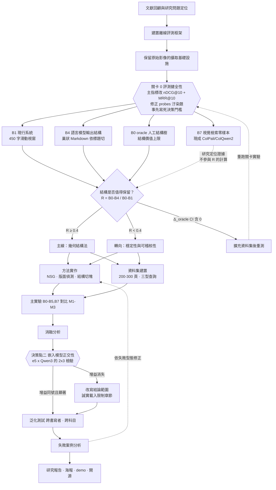

# 研究流程修改建議 v1

> 對象：`hand_off.md` 的〈參、研究流程〉與〈肆、研究方法與步驟〉。
> 依據：`文獻回顧.md` 的七篇文獻，以及 `probes.md` / `lv.0_校正問題.md` 的現況。
> 體例：每一條都寫成「原本 → 改成 → 為什麼 → 成本」。沒有理由的修改不列。
>
> **這份文件不取代 `hand_off.md`。** 確認要改哪幾條之後，再回頭改 `hand_off.md` 的正文，兩份保持一致。

---

## 零、修改總覽

七項修改，按「該先做」排序。**前三項在資料蒐集開始前就要定案，否則之後全部要重跑。**

| # | 修改 | 影響範圍 | 成本 | 急迫性 |
|---|---|---|---|---|
| 1 | 主要指標改為 nDCG@10 ＋ MRR@10 | 全部實驗 | 半天 | **立刻** |
| 2 | 修掉 `probes.md` 第 17、18 題的評測汙染 | B0 可信度 | 十分鐘 | **立刻** |
| 3 | 關卡實驗的決策門檻改成寫死的數值 | 階段 1 的判定 | 一小時（設計） | **立刻** |
| 4 | 新增 `B7` ColPali 零樣本視覺檢索基線 | 研究定位 | 1–2 天 | 高 |
| 5 | 新增 `B5` contextual retrieval | M2 的定位 | 3–5 天 | 中 |
| 6 | 新增嵌入模型軸 `E`，做正交性檢驗 | 結論的穩健性 | 2–3 天 | 中 |
| 7 | 流程圖加一個前置關卡與第二個決策點 | 階段 0、階段 3 | 隨 1–6 而定 | 中 |

> **只做得起三件事的話，做 1、2、3。** 這三件不花錢，但決定了後面所有數字能不能用。

---

## 壹、修改 1：主要指標

### 原本

> 檢索品質（主要）：Recall@10、nDCG@10
> 檢索品質（次要）：Recall@1、Recall@5、MRR@10

### 改成

| 類別 | 指標 |
|---|---|
| **主要** | nDCG@10、MRR@10 |
| **次要** | Recall@1、Recall@5、Recall@10 |
| 當 gold node set 有多個節點時（階段 2 之後） | Recall@10 升回主要指標 |

### 為什麼

現在 `probes.md` 每一題**只有一個正解頁**。單一 gold 的情況下 Recall@10 只有兩種值：0 或 1。29 題就是 29 個 0/1，區分度極低——B1 和 M2 很可能都是 26/29，看起來沒差，實際上一個排第 2 名、一個排第 9 名。

MRR@10 對「排在第幾名」敏感，正是這個階段需要的解析度。nDCG@10 是 ColPali（論文 4）與整個 ViDoRe 系列的主指標，可比性也好。

等階段 2 的資料集做起來、每題標註的是 gold **node** set（多個節點）而非單一頁，Recall 才恢復意義，那時再把它升回主要指標。

> 這一條要順便修改〈肆、四、評測方法〉的指標表，以及所有已經跑過的 B0/B1/B4 結果——**重算即可，不用重跑檢索**，排名資料應該都還在。

---

## 貳、修改 2：修掉評測汙染

### 原本

`probes.md` 第 17 題（`cs-pointer`，關鍵詞 `記憶體位址`）、第 18 題（`cs-structured-binding`，關鍵詞 `結構化綁定`）。

### 改成

依 `lv.0_校正問題.md` 的建議二選一：

| 方案 | 作法 |
|---|---|
| **A（建議）** | 關鍵詞改成原稿真的有的字：p08 用 `pointer of int`，p15 用 `make_tuple`。題目文字跟著調整 |
| B | 把這兩題排除在所有 B0 對照之外，題數從 29 降為 27，並在報告中說明排除理由 |

### 為什麼

這兩題的關鍵詞**是 Gemini 在 B1 階段自己加上的，原稿上沒有**。用它們評分等於「用 B1 的產物去評 B0」，B0 的分數建立在 B1 的幻覺上，兩組不可比。

這是評測汙染（evaluation contamination）。ColPali（論文 4 §4.2）明確檢查訓練集與 ViDoRe 之間沒有共用文件，就是在防同一類問題——所以你們處理這件事有文獻依據可引，寫進報告反而是加分項，不是要藏起來的瑕疵。

> **報告寫法建議**：在資料集章節誠實寫出「初期題組中發現 2 題的正解關鍵詞源自基線系統的自動生成內容而非原始筆記，已依 X 方案修正」。評審看到這種自我檢查，對整份資料集的信任度會提高。

---

## 參、修改 3：關卡實驗的決策門檻要寫死

### 原本

| 觀察到的結果 | 判定 | 後續路線 |
|---|---|---|
| 幾何法有空間 | 主線 | 依原計畫開發版面偵測 |
| 模型推論已足夠 | 轉向 | 改以假設三為主軸 |
| 結構不顯著 | 重測 | 擴充資料集後回到階段 1 |

### 問題

「幾何法有空間」不是一個可以判定的條件。跑完實驗看到三個數字之後，還是要靠感覺決定走哪條路——而人在投入了三個月之後，一定會覺得「還有空間」。**決策點如果沒有寫死的數值，它就不是決策點，只是一張圖上的菱形。**

### 改成

先定義兩個量：

```
Δ_oracle = B0 − B1     結構的總價值（人工完美結構相對現行系統的增益）
Δ_llm    = B4 − B1     語言模型推論結構已經取回的部分
R        = (B0 − B4) / Δ_oracle    幾何法可爭取的剩餘比例
```

判定規則（主指標 nDCG@10，配對 bootstrap 10,000 次）：

| 條件 | 判定 | 路線 |
|---|---|---|
| Δ_oracle 的 95% CI **包含 0** | 結構不顯著 | 擴充資料集後重跑階段 1 |
| Δ_oracle 顯著 > 0 且 **R ≥ 0.4** | 幾何法有空間 | **主線**：開發版面偵測 |
| Δ_oracle 顯著 > 0 且 **R < 0.4** | 模型推論已足夠 | **轉向**：以 H3（穩定性與可稽核性）為主軸 |

R = 0.4 的意思是：如果 LLM 自己推的結構已經吃掉六成以上的結構價值，剩下不到四成不值得再花七週開發版面偵測模組。

> **這個門檻要在跑實驗之前寫下來、寫進 `hand_off.md`，不能看到數字之後再訂。** 這是研究方法上最基本的一件事，也是評審會特別看的地方。0.4 這個值可以討論（0.3 或 0.5 都合理），但**必須事先決定**。

### 附帶條件：關卡實驗的結論要標明是 pilot 級

目前 66 頁、29 題（修正後 27 題）。這個規模跑不出可靠的信賴區間，R 的估計會很不穩。建議：

- 關卡實驗的結果在報告中標為 **pilot**，用來決定路線，不作為最終結論
- 若 R 落在 0.3–0.5 之間（模糊地帶），**不要硬做決定**，先把資料集擴到至少 100 頁再重跑一次

---

## 肆、修改 4：新增 `B7` — ColPali 零樣本視覺檢索基線

### 這是這份文件裡收益最高的一項建議

### 原本

實驗組別只有 B0–B4（全部是文字管線）＋ M1–M3。

### 改成

新增一組：

| 代號 | 名稱 | 作法 | 設立理由 |
|---|---|---|---|
| `B7` | 視覺檢索（零樣本） | 直接把頁面影像餵給現成的 ColPali / ColQwen2 checkpoint，用 late interaction 檢索，**不做任何 OCR、切塊或訓練** | 回答「為什麼不用 ColPali 就好」 |

實作只需要：現成 checkpoint（`vidore/colpali-v1.3` 或 `vidore/colqwen2-v1.0`）＋ 你們已經有的 66 張頁面影像 ＋ 27 題查詢。**不用訓練、不用標註，一到兩天可以跑完。**

### 為什麼

ColPali 在 ViDoRe 上拿 nDCG@5 81.3，把最好的文字管線（67.0）打掉 14 分，索引還快 18 倍。這件事你們在口試一定會被問，而且**引用文獻回答遠不如拿出自己的數據回答**。

兩種結果都對你們有利：

| B7 的結果 | 意義 | 怎麼寫 |
|---|---|---|
| **B7 明顯低於 B1**（我的預期） | ColPali 在手寫繁中筆記上不成立 | 「視覺檢索方法在其訓練分布（英文數位 PDF）之外顯著退化。本研究場域的手寫繁體中文筆記不在該分布內，實測 nDCG@10 為 X，低於現行文字管線的 Y。」——**這一句話就把整個路線之爭關掉了** |
| B7 接近或高於 M2 | 需要正視 | 那就把研究定位調整為「可稽核性與端到端可用性」：ColPali 回傳不了文字，做不了注音還原（Hand-off 2）、無法顯示筆記、無法讓學生修正。這仍是一個完整的研究結論，不是失敗 |

即使是第二種結果，你們也不會空手——但**不做 B7，兩種情況都無法回答**。

### 額外收穫

論文 5（SIGIR'25 複現研究）的 RQ3.3 指出：late interaction 在影像上仍靠詞彙匹配，query token 會對到「含相同字形的 patch 或其相鄰 patch」。所以頁面上寫著 `ㄈㄨˊㄕㄜˋ` 的地方，query「輻射」匹配不上——**B7 順便替 Hand-off 2 的注音研究提供了證據：注音問題是任何檢索路線都繞不過的，不是文字管線特有的缺陷。** 這讓 Hand-off 2 從「順手做的功能」升級為獨立的研究缺口。

---

## 伍、修改 5：新增 `B5` — contextual retrieval

### 原本

`M2` = `M1` ＋ 祖先路徑注入嵌入文字。目前唯一的對照是 `M1`（沒有注入）。

### 改成

新增一組：

| 代號 | 名稱 | 作法 |
|---|---|---|
| `B5` | LLM 脈絡前綴 | 固定長度切塊後，對每個 chunk 用 LLM 生成一段「這段在整頁筆記中的位置與角色」的說明，前綴到 chunk 上再嵌入（Anthropic contextual retrieval 作法） |

同時在成本表中記錄 B5 與 M2 的每頁攝取時間與 API 成本。

### 為什麼

沒有 B5，M2 只能證明「有注入比沒注入好」。有了 B5，才能證明真正想講的那句話：

> **祖先路徑注入是 contextual retrieval 的確定性、零推論成本版本——脈絡不是被生成的，而是從版面結構中被讀出的。**

論文 2（Reconstructing Context）實測 contextual retrieval 效果最好但很貴（20GB VRAM、每頁要跑一次 LLM）。如果 M2 打平 B5 而成本低一到兩個量級，且輸出可稽核（祖先路徑是筆記上真的寫的字，LLM 生成的脈絡不是），這個結論比「M2 > M1」強太多。

### 順帶：B3 的規格要寫死

原本 B3 只寫「以相鄰句嵌入相似度的谷點斷句」，別人重跑不出來。建議直接採用論文 3（RSC）的門檻作為 B3 的實作規格：

| 參數 | 值 |
|---|---|
| 遞迴切塊門檻 `Tchunk` | 1,500 字元 |
| 最終上限 `Tfinal` | 2,500 字元 |
| 合併下限 `Tmerge` | 350 字元 |
| 遞迴時的門檻遞減量 `δ` | 3 |

**同時把 RSC 的「小 chunk 與前後相似度較高者合併」規則搬進 `M1`。** 沿 NSG 子樹切塊一定會產生零碎節點（例如 `一下地科三段` p07–p10 那種只有一個姓名的頁面），現在沒有處理規則，這是現成解法。

---

## 陸、修改 6：新增嵌入模型軸 `E`，做正交性檢驗

### 原本

> 所有比較都在同一份資料集、同一個嵌入模型（e5）、同一個 HNSW 組態下進行，只變動切塊方式。

這個設計本身是對的（內部效度），但不夠。

### 改成

保留主實驗的單一嵌入模型不變，**另外加做一個 2×3 的穩健性檢驗**：

| | `B1` 現行 | `B3` 語意切塊 | `M2` 本方法 |
|---|---|---|---|
| `E1` = e5（現行） | | | |
| `E2` = Qwen3-Embedding-0.6B | | | |

判定：若 M2 相對 B1 的增益在 E1 與 E2 下**同號且都顯著**，則結論從「在特定嵌入模型上有效」升級為「與嵌入模型正交」。

### 為什麼

論文 1（Is Semantic Chunking Worth It?）量到一件事：**換嵌入模型的增益常常大於換切塊策略的增益**——stella 換掉 bge-large，平均提升 7.44%，p = 1.59×10⁻⁵。而論文 7 顯示 Qwen3-Embedding-0.6B 在中文（CMTEB 66.33）明顯優於 multilingual-e5-large-instruct（62.0）。

所以如果 M2 相對 B1 的增益是 3–5%，評審完全可以問：

> 「這 5% 換個嵌入模型也拿得到，為什麼要做這麼複雜的版面幾何？」

這一組實驗就是答案。**成本很低**——只要重跑嵌入與索引，不用重做任何標註，也不用改切塊程式碼。

### 如果時間真的不夠

至少在報告的限制章節誠實寫出：「本研究固定嵌入模型為 e5，未檢驗結構切塊的增益在其他嵌入模型下是否保持。」寫出來比被問出來好。

---

## 柒、修改 7：修訂後的流程圖

### 主要改動

1. 階段 0 之後、關卡實驗之前，加一道 **關卡 0：評測健全性檢查**（修改 1、2 的內容）
2. 關卡實驗加入 `B7`（視覺檢索基線）
3. 決策點標上寫死的門檻（修改 3）
4. 階段 3 加入 **決策點二：嵌入模型正交性檢驗**

### 修訂後的圖



### 兩個決策點的分工

| 決策點 | 問的問題 | 回答錯的後果 |
|---|---|---|
| 一（階段 1） | 結構值不值得保留？該由誰產生？ | 花七週開發一個沒有價值的模組 |
| 二（階段 3） | 增益是結構帶來的，還是嵌入模型帶來的？ | 結論被一句話推翻 |

> **口試題「如果你的假設是錯的怎麼辦」的答案，現在有兩層。** 原本只有第一個菱形；加上第二個之後，連「假設對但原因錯」的情況也有處置路線。回答時兩個都指。

---

## 捌、修訂後的組別總表

把上面的修改合起來，實驗矩陣變成：

### 基準線

| 代號 | 名稱 | 切塊／檢索方式 | 狀態 |
|---|---|---|---|
| `B0` | oracle 人工結構 | 人工校正文字 ＋ 人工結構樹，沿子樹切塊 | 原有 |
| `B1` | 現行系統 | LLM 純文字 → 450 字滑動視窗，重疊 80 字 | 原有 |
| `B2` | 固定長度調參後 | 同上，窗長與重疊經網格搜尋 | 原有 |
| `B3` | 語意切塊 | 相鄰句嵌入相似度谷點斷句，**門檻採 RSC 規格** | 原有，補規格 |
| `B4` | 模型推論結構 | LLM 輸出巢狀 Markdown → 依標題層級切塊 | 原有 |
| `B5` | LLM 脈絡前綴 | 固定長度切塊 ＋ LLM 生成脈絡前綴（contextual retrieval） | **新增** |
| `B7` | 視覺檢索零樣本 | 現成 ColPali / ColQwen2，直接嵌影像 | **新增** |

> `B6` 保留給 late chunking（整頁 token 級嵌入後再切）。**列為選配**：需要長上下文嵌入模型，且論文 2 顯示它效果不穩，優先度低於 B5 與 B7。

### 本研究方法

| 代號 | 組成 | 狀態 |
|---|---|---|
| `M1` | NSG 子樹切塊（僅層級），**加入小 chunk 相似度合併規則** | 原有，補規則 |
| `M2` | `M1` ＋ 祖先路徑注入嵌入文字 | 原有 |
| `M3` | `M2` ＋ 關聯邊擴展 | 原有 |

### 消融組

原有四項（移除層級／祖先路徑／強調權重／關聯邊），**建議加第五項**：

| 消融 | 內容 | 目的 |
|---|---|---|
| `M2` − 小 chunk 合併 | 關掉合併規則，讓零碎節點自成一個 chunk | 分離「結構」與「chunk 長度分布」兩個因素的貢獻。沒有這一項，評審可以說增益其實只是 chunk 變得比較均勻 |

### 軸

| 軸 | 值 | 用途 |
|---|---|---|
| 切塊策略 | B0–B5、B7、M1–M3 | 主實驗 |
| 查詢型別 | Q1 / Q2 / Q3 | 檢定 H2（機制） |
| 嵌入模型 `E` | e5 / Qwen3-Embedding-0.6B | 穩健性檢驗（僅 B1 / B3 / M2 三組） |
| 書寫者 | 開發集 / 測試集（不重疊） | 泛化 |
| 科目 | 數理 / 文史 | 泛化 |

---

## 玖、修訂後的時程

改動處以 **粗體** 標示。總長度不變，仍是 24 週。

| 週次 | 工作 | 改動 |
|---|---|---|
| **1** | **關卡 0：修 probes 汙染題、改主指標、寫死決策門檻** | **新增（但只花一週的一小部分，其餘時間併入下一列）** |
| 1–3 | 文獻回顧、離線評測框架、影像保留基礎設施 | 文獻回顧要補齊缺口（見下節） |
| **2–3** | **B7 視覺檢索基線 pilot** | **新增。與評測框架平行，兩天的事** |
| 4–6 | 關卡實驗（`B0`、`B1`、`B4`）與決策 | 決策依修改 3 的數值門檻 |
| 5–14 | 資料蒐集與標註 | 不變（仍是關鍵路徑，仍須最早啟動） |
| 7–14 | 方法實作（NSG、版面偵測、結構切塊） | 不變 |
| **10–12** | **`B5` contextual retrieval 實作與量測** | **新增。與方法實作平行** |
| 15–18 | 主實驗、消融、泛化測試 | 主實驗範圍擴大到 B0–B5、B7 |
| **17–18** | **嵌入模型正交性檢驗（2×3）** | **新增。併入主實驗期，不佔額外週次** |
| 19–21 | 失敗案例分析與方法迭代 | 不變 |
| 22–24 | 研究報告、海報、展場 demo、開源整理 | 不變 |

> **關鍵路徑沒有變**，仍然是第 5 週就必須啟動的資料蒐集與標註。新增的三項（B7、B5、正交性檢驗）都是與既有工作平行、且不依賴標註完成的工作，所以不壓縮關鍵路徑。

---

## 拾、文獻回顧要補的缺口（第 1–3 週）

`文獻回顧.md` 已列，這裡只重申優先序。**前三項不補，第二章寫不完整。**

| 優先 | 缺口 | 為什麼非補不可 |
|---|---|---|
| 1 | **階層式 / 樹狀 RAG**（RAPTOR 一類） | 你們的核心主張就是「沿結構樹切塊」，卻沒有任何一篇談樹狀組織 RAG 的文獻。評審必問「有人做過嗎」 |
| 2 | **Contextual retrieval 原文**（Anthropic 2024） | `B5` 的規格來源，也是 `M2` 最重要的定位對象 |
| 3 | **文件版面分析**（layout analysis、reading order、LayoutLM、DocLayNet） | 目的 3-2、3-3 的整個技術基礎 |
| 4 | ColBERT 原文（Khattab & Zaharia 2020） | 論文 4/5/6 全都建立在它之上 |
| 5 | Late chunking 原文（Günther et al. 2024） | 若要做 `B6` 則必補 |
| 6 | 手寫辨識（HTR）、繁中手寫 | 輸入端的雜訊上限 |
| 7 | 注音／中文輸入法轉換 | Hand-off 2 的 `Z1` 依據 |
| 8 | 檢索評測的統計方法 | 配對 bootstrap、Holm–Bonferroni、Cliff's delta 的方法學引用 |

---

## 拾壹、不要改的地方

以下四項是原計畫裡最好的部分，任何刪減版本都要保留。

**1. 標註手冊不得寫入幾何規則。**
`hand_off.md` 那段警告是整份計畫方法論上最精確的一段：如果標註者依「左緣縮排 ≥ 某像素即為下一層」建樹，B0 就等於幾何演算法的輸出，M1–M3 的比較變成循環論證。**這條不能為了標註速度而放寬。**

**2. 目的 1-4（oracle 上限）與目的 2-2（重複穩定性）。**
論文 1 在 Limitations 明說缺少 chunk 層級的 ground truth；論文 2 在 Limitations 提了一句生成式切分「輸出不一致」。**這兩件別人只寫在限制章節的事，你們把它們做成了正式的對照實驗。** 這正是評審判斷「研究 vs 作品展示」的依據，篇幅不夠時砍別的。

**3. 「保留原始影像的攝取基礎設施」排在最前面。**
`add_image_note()` 現在只存文字。這件事不先做，第 9 週要跑幾何法時前面收的筆記全部作廢。

**4. B2 與 B3 不能省。**
只跟 B1 比等於跟自己半年前的版本比。論文 1 進一步顯示 B3（語意切塊）其實是一個被業界高估的基線——這讓 B3 的存在更有價值，因為你們可以說「我們跟一個被普遍相信但學術上未獲證實的方法比較」。

---

## 拾貳、確認清單

改 `hand_off.md` 之前，先確認下面每一項要不要採納：

- [ ] 主指標改 nDCG@10 ＋ MRR@10
- [ ] `probes.md` 第 17、18 題採 A 方案（改關鍵詞）或 B 方案（排除）
- [ ] 決策門檻 R 的值定為 ____（建議 0.4），且**在跑實驗前**寫進 `hand_off.md`
- [ ] 新增 `B7` 視覺檢索基線
- [ ] 新增 `B5` contextual retrieval
- [ ] 新增嵌入模型軸 `E`，做 2×3 正交性檢驗
- [ ] `B3` 採用 RSC 門檻規格
- [ ] `M1` 加入小 chunk 相似度合併規則，並新增對應的消融項
- [ ] 流程圖換成修訂版（關卡 0 ＋ 決策點二）
- [ ] 時程表加入第 2–3 週的 B7 pilot、第 10–12 週的 B5、第 17–18 週的正交性檢驗
- [ ] 文獻回顧補齊前三項缺口
