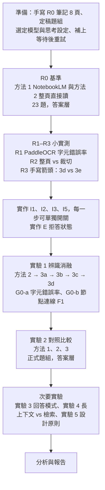

# NoteHandler 實驗架構

> 2026-09-21 重新產生，取代先前版本。整個研究的實驗設計：假設、比較的方法、變數、資料、指標的計算方式、流程、統計分析與效度威脅。
> 2026-11-02 補上第十一節：R0 基準、第一個提示詞實驗、多次辨識投票與開源模型比對的結果。
> 專案總文件是 [專題總覽.md](專題總覽.md)（項目代號 R、I、G、E 沿用它）；文獻依據見 [文獻整理.md](文獻整理.md)。
> 本文件的「實驗 1–5」和總覽的產品項目 E（「筆記裡沒有」狀態）不同，請勿混淆。

---

## 一、研究問題與假設

**題目：** 手寫筆記的結構忠實辨識與可驗證問答。

**一句話：** 主張「**回答**比 NotebookLM 準」，並用「**辨識**比直接讀準」證明原因。

| 假設 | 內容 | 比較對象 | 角色 |
|---|---|---|---|
| **H1** | 疊加前處理、版面切割與裁切、多次辨識投票、圖形轉 Mermaid 等步驟，能提升**辨識正確率** | 方法 3 vs 方法 2 | 機制 |
| **H2** | 方法 3 的**回答正確率**高於 NotebookLM，尤其是箭頭、圖解題 | 方法 3 vs 方法 1 | **主要主張** |
| **H3** | H2 的差距來自辨識：方法 3 因「讀錯字、讀錯圖」而答錯的比例較低 | 各方法答錯的題目 | 連結 H1 與 H2 |

**前提（作者決定，2026-09-21）：**
- 所有量測都用系統**直接產生、未經人工修正**的辨識稿與答案。程式發現問題時自動重讀或投票，不交給使用者。
- 「使用者能不能發現錯誤」的使用者實驗暫停（總覽 G4）。
- 手寫注音不在研究範圍內（客群不同）。

---

## 二、比較的方法

| # | 方法 | 內容 | 看得到辨識稿？ |
|---|---|---|---|
| 1 | **NotebookLM** | 上傳原圖，分科開 notebook 直接問 | **否** |
| 2 | **整頁直接讀**（NoteHandler 目前做法） | 整頁一次送 Gemini 辨識，再用 NoteHandler 回答 | 是 |
| 3a | 2 ＋ **I1 前處理** | OpenCV 拉正、透視校正、提高對比 | 是 |
| 3b | 3a ＋ **I2 版面切割與裁切放大** | PP-StructureV3 或 MinerU 切出文字、公式、圖形區塊，逐塊放大送 Gemini | 是 |
| 3c | 3b ＋ **I3 多次辨識投票** | 每個文字區塊由 Gemini（整區、放大重讀）與 PaddleOCR 各讀一次，程式逐字投票 | 是 |
| 3d | 3c ＋ **I5 圖形轉 Mermaid（TextFlow 式）** | 圖形區塊 → Gemini 輸出 Mermaid＋座標 → 程式驗證，不合法就重新產生 | 是 |
| （3e） | 3c ＋ **I5 Arrow-guided 式** | 先偵測箭頭起訖點與節點、OCR 讀節點文字，連同座標交給 Gemini | 是；**3d 夠好就不做** |

- 3a → 3d 是**逐步疊加的消融序列**，每加一步量一次。
- 「方法 3」在假設中指序列的最後一步（3d，或做了的話 3e）。
- 3a–3c 的順序可依 R1、R2 的結果調整；在小實測中沒有幫助的步驟，仍保留在序列中量測，但不放進最終流程。
- 3e 的缺口：**手寫箭頭沒有現成的偵測器**（Arrow-Guided VLM 論文用的是印刷流程圖的偵測器）。替代方案是請 Gemini 回傳箭頭座標框（偵測仍交給 LLM，與 3d 差距變小），或訓練小型偵測器（總覽 X2，需自行標註）。

### 各方法能比的層級

| 指標層級 | 方法 1 NotebookLM | 方法 2、3 |
|---|---|---|
| 辨識層（字元錯誤率、節點／連線 F1） | **不能**：來源唯讀，看不到辨識稿 | 可以 |
| 答案層（正確率、幻覺、出處、拒答） | 可以 | 可以 |

**辨識層沒有外部對照組**，只能和方法 2 比。被問「NotebookLM 的字元錯誤率是多少」時，答案是「不知道，也沒有宣稱」。R0 時實際確認 NotebookLM 有無顯示辨識稿的介面；若有，只當補充數字。

---

## 三、變數

### 3.1 自變數

| 實驗 | 自變數 | 水準 | 總覽代號 |
|---|---|---|---|
| **實驗 1 辨識消融**（主實驗） | 辨識流程 | 方法 2、3a、3b、3c、3d（、3e） | G1 辨識層 |
| **實驗 2 對照比較**（主實驗） | 系統 | 方法 1、方法 2、方法 3 | G1 答案層 |
| 實驗 3 回答模式 | 回答提示詞 | P0 目前的版本（改寫）／P1 CP-Link（引用原句） | G5 |
| 實驗 4 長上下文 vs 檢索 | 送給模型的方式 | 整份送入／切塊檢索／依原順序檢索 | G2 |
| 實驗 5 設計原則消融 | 誰做判斷 | 程式核對出處 vs LLM 判斷；使用者選類別 vs 全部類別 | G3 |

實驗 1、2 是主實驗；實驗 3–5 是次要實驗，各自獨立進行，一次只改一個自變數。

### 3.2 控制變數

| 項目 | 固定為 | 狀態 |
|---|---|---|
| **辨識與回答模型** | 同一個 Gemini 模型與版本，全程不換 | **`gemini-3.1-flash-lite`**（2026-11-02 作者選定：產品預設，量的是使用者實際用到的版本） |
| **思考設定** | 開或關、思考 token 上限，全程固定 | 程式沒有設定，使用模型預設值。目前所有執行都相同，但未明確寫死；之後要改成明確設定 |
| 生成參數 | temperature 0 | 程式已是如此 |
| 辨識提示詞 | 同一版；3b 之後的逐區塊提示詞只多一句「這是一個區塊」，內容規則相同 | — |
| 回答提示詞 | 實驗 1、2 固定用 P0；只有實驗 3 改變 | — |
| 原始檔 | 同一批照片，同解析度、同檔名；一頁一張圖，不合成 PDF | — |
| 發問範圍 | 分科：NoteHandler 選該題所屬類別；NotebookLM 一科一個 notebook | — |
| 發問方式 | 題目原封不動、每題開新對話、只問一次 | — |
| 整份送出上限 | 60,000 字元（實驗 4 除外） | — |

**NotebookLM 的底層模型版本無法得知也無法固定**，寫進報告的限制。

### 3.3 執行穩定性

- 熱門模型在高峰時段常回 **503「需求過高」**（2026-09-21 實測：看圖時兩把金鑰各失敗一次、第三次才成功）。2026-11-02 的提示詞實驗也因此失敗兩次，第三次才跑完。
- `eval/r0/run_baseline.py` 已有**等待後重試**：等待時間逐次加倍（30、60、120 秒…），最多 6 次。重試不影響結果，只影響時間；一題最終仍失敗會記錄錯誤、不從資料中刪除；辨識失敗則整次執行中止，換新資料夾重跑。

### 3.4 應變數

見第五節「指標」。

---

## 四、資料

### 4.1 筆記

| 資料組 | 內容 | 狀態 | 用途 |
|---|---|---|---|
| **G0-a 真實筆記** | 6 份 PDF、66 頁，作者 8 月已人工校正辨識稿（`eval/g0/transcripts/`）；另有舊模型的整頁辨識結果（`eval/g0/baseline_gemini_whole_page.json`） | ✅ 已有 | 實驗 1 的**文字**部分（字元錯誤率） |
| **G0-b R0 筆記** | 8 頁、3 科（地科、生物、歷史），依 `eval/r0/手寫筆記稿.md` 手寫，含 4 頁箭頭或圖解（第 2、5、6、7 頁） | ⬜ 待手寫 | 實驗 1 的**圖形**部分（節點／連線 F1）、實驗 2 |
| G0-c 補充 | 更多含箭頭、圖解的真實筆記，最好來自不同組員 | ⬜ 視 R0 結果 | 擴大圖形部分與實驗 2 的樣本、增加筆跡來源 |

**注意：**
- G0-a 的校正稿為了舊實驗加上了 Markdown 標題，算字元錯誤率前先去掉（見 5.1 的正規化）。
- G0-a 的整頁辨識結果是 8 月用舊模型跑的，**正式實驗 1 要用選定的模型重跑**方法 2。
- G0-a 沒有箭頭題與結構標註。圖形部分主要靠 G0-b：它的**標準節點與連線已經定義在手寫筆記稿的【圖】區塊裡**，不需另外標註。
- 所有筆記、標準稿、標註、題組答案、掃描檔都**不進 git**（`.gitignore` 已設定）。

### 4.2 題組

每題有標準答案與所在頁碼，**在任何系統作答前定稿**，看過回答後不能修改。

| 類別 | 意思 | R0（G0-b） | 正式 |
|---|---|---|---|
| A 單頁文字題 | 單頁、看文字就答得出來 | 8 | 視 G0-a 補題 |
| B 跨頁題 | 需整合同一科的多頁 | 3 | 視 G0-a 補題 |
| C 看圖題 | 資訊只畫在圖上，要讀懂箭頭或圖解 | 8 | 隨 G0-c 增加 |
| D 筆記裡沒有 | 正確行為是說「筆記沒有提到」 | 4 | 同科、筆記沒寫的內容 |

- R0 的 23 題在 `eval/r0/題組與標準答案.md`（不進 git）。
- 外部的 235 題題組（對應 G0-a）可沿用，補上 C、D 兩類後當正式題組。
- C 類中答案本身是課本常識的題目（R0 的 C2、C3、C5、C6），要一併看出處是否指到圖所在的頁；答對但出處不對記為「可能未讀圖」。C1、C4、C7、C8 較依賴圖的細節。

---

## 五、指標與計算方式

### 5.1 辨識層（只有方法 2、3）

**字元錯誤率（CER）**，依 OmniDocBench／OCRBench v2 的編輯距離定義：

```
CER = 編輯距離(系統辨識稿, 標準稿) ÷ 標準稿字元數
```

- **逐頁計算**，報告整體（全部頁加總）與逐頁分布；另外分開報告**公式區**與**一般文字區**。
- **比較前兩邊做同樣的正規化**（寫成程式，兩邊一致套用）：
  - 去掉 Markdown 標題記號、清單符號、粗體記號
  - 去掉系統產生的固定句（「這是一份【科目】科的筆記」「關鍵字：」行、「## 第 N 頁」）
  - 全形與半形統一，空白與換行合併
  - LaTeX 只比較內容：例如 `$CO_2$` 與 `CO₂` 視為相同

**節點／連線 F1**，依 MindBench 的結構解析指標：

- **節點**：正規化後的文字，編輯距離 ≤ 1 個字，或在節點長度 20% 以內，視為同一節點（門檻事先定好，不看結果再調）。
- **連線**：有方向的三元組（起點, 終點, 箭頭上的文字）。起點與終點都對上才算對；箭頭文字另外報告正確率。
- **精確率** = 對的連線數 ÷ 系統輸出的連線數；**召回率** = 對的連線數 ÷ 標準連線數；F1 為兩者調和平均。
- 方法 2 沒有 Mermaid 輸出：由評分者依它的文字描述，整理出它「表達了哪些連線」再比對。這一步是人工判定，由兩位評分者各自做並計算一致性。

**其他記錄：** 每頁辨識時間、Gemini 呼叫次數、思考 token 數、503 重試次數、I5 重新產生的次數、I3 投票後仍決定不了的字數。

### 5.2 答案層（所有方法）

| 指標 | 定義 | 依據 | 計算方式 |
|---|---|---|---|
| 答案正確率 | 正確 ÷ 題數；「部分正確」另列 | — | 人工對照標準答案 |
| 沒有依據的句子比例 | 筆記沒寫或與筆記矛盾的句子 ÷ 全部句子；分「與資料矛盾」「資料以外的內容」 | RAGTruth、RAGAS Faithfulness 的定義 | 人工逐句判定 |
| 引用召回率 | 有出處、且出處內容支持的句子 ÷ 全部需要出處的句子 | ALCE | 人工 |
| 引用精確率 | 支持該句的出處 ÷ 全部出處 | ALCE | 人工 |
| 出處頁碼正確率 | 出處指到標準答案所在頁 ÷ 有出處的題數 | — | NoteHandler 程式比對；NotebookLM 人工讀它指到的段落 |
| 正確拒答率 | D 類中正確表示「筆記沒有」÷ D 類題數；另報 A–C 類的**錯誤拒答率** | — | NoteHandler 用拒答字串判斷（總覽 E）；NotebookLM 人工 |
| 複製程度（實驗 3） | 答案中能在送出的筆記裡找到逐字相同片段的字元比例 | Copy-Paste（ICLR 2026） | 程式 |
| **答錯原因**（H3） | 讀錯字／讀錯圖／推理錯／用了筆記外知識 | — | 方法 2、3 對照辨識稿**確認**；NotebookLM 只能從答案**推測**，備註註明 |

所有答案層指標都**依題型（A、B、C、D）分開報告**；H2 的重點是 C 類。

### 5.3 評分流程

- **不用 LLM 當評審**（位置偏誤，且違反設計原則）。人工標註或程式計算。
- 每個人工判定的欄位由**兩位評分者各自評分**，計算 Cohen's κ；κ < 0.6 的欄位先討論、修正判定規則，再重評。不一致的題目兩人討論決定，保留原始兩份評分。
- **盡量盲評**：去掉系統名稱、打亂順序後再評。出處格式不同（NotebookLM 與 NoteHandler 的標記長得不一樣），無法完全盲評，寫進限制。
- 判定規則（部分正確、沒有依據的句子、答錯原因）在看到任何答案前寫好，見 `eval/r0/題組與標準答案.md` 的「判定原則」。

---

## 六、實驗流程



| 階段 | 內容 | 產出 | 總覽代號 |
|---|---|---|---|
| 0 準備 | 手寫 G0-b；定稿 R0 題組；**選定並記錄模型與思考設定**；補上 503 等待後重試 | 8 張照片、定稿題組、設定紀錄 | G0 |
| 1 R0 基準 | NotebookLM 與目前的 NoteHandler 各答 23 題；確認 NotebookLM 有無顯示辨識稿的介面 | 兩份評分表；H2 的初步數字；最弱題型 | R0 |
| 2 小實測 | R1、R2、R3 | 決定 I1–I3、I5 的做法與順序 | R1–R3 |
| 3 實作 | I1、I2、I3、I5，每一步以設定開關；E 拒答狀態 | 可跑消融的辨識流程 | I、E |
| 4 實驗 1 | 方法 2 到 3d 逐步量測辨識層 | H1 的結果 | G1 |
| 5 實驗 2 | 正式題組上三個系統的答案層比較，含答錯原因 | H2、H3 的結果 | G1 |
| 6 次要實驗 | 實驗 3、4、5 | 回答模式、長上下文、設計原則的結果 | G5、G2、G3 |
| 7 報告 | 統計分析、限制 | 報告 | — |

**重複執行：** 2026-11-02 實測，`gemini-3.1-flash-lite` 在 temperature 0 下同一條件跑兩次，辨識稿的錯字與 23 題的答案**完全相同**（第十一節）。因此每個條件跑 **1 次**，並在每次換模型或換設定時加跑 1 次重複確認；若出現差異，再改為各跑 3 次、報告平均與範圍。NotebookLM 是手動操作，每題只問一次。

---

## 七、統計分析

| 比較 | 資料單位 | 檢定 | 報告 |
|---|---|---|---|
| 實驗 1 字元錯誤率：相鄰兩步（例如 3a vs 3b） | 每頁（配對） | Wilcoxon 符號等級檢定 | 差值中位數、bootstrap 95% 信賴區間 |
| 實驗 1 節點／連線 F1 | 每張圖（配對） | Wilcoxon；圖數少時只報信賴區間 | F1 與 bootstrap 95% 信賴區間 |
| 實驗 2 答案正確率：方法 3 vs NotebookLM | 每題（配對，對／錯） | McNemar 精確檢定 | 正確率差、不一致題數、95% 信賴區間 |
| 實驗 2 依題型 | 每題 | 同上，分 A–D 類 | C 類是重點 |
| H3 答錯原因 | 答錯的題目 | 比例與 Fisher 精確檢定 | 「讀錯字＋讀錯圖」占答錯的比例 |
| 多重比較 | 實驗 1 的多個相鄰步驟 | Holm 校正 | 校正後的 p 值 |

**樣本數：**
- R0 只有 23 題（C 類 8 題），**只能看出明顯差異和最弱的題型，不能下結論**。
- 正式實驗 2 的題數，依 R0 觀察到的「不一致題比例」估算 McNemar 需要的題數後再決定，避免重演舊研究線「可偵測的效果太大」的問題。
- 實驗 1 的文字部分有 66 頁，逐頁配對，樣本相對足夠；圖形部分頁數少，以信賴區間為主。

**事先寫好：** 假設、主要指標（H1：整體字元錯誤率與連線 F1；H2：C 類與整體答案正確率）、檢定方法、判定門檻，在跑實驗 1、2 之前寫進本文件，之後不依結果更改。

---

## 八、結果解讀

| 結果 | 解讀 | 接下來 |
|---|---|---|
| H1、H2 都成立 | 辨識變準，回答也比 NotebookLM 準 | 用 H3 確認差距來自辨識 |
| H1 成立、H2 不成立 | 辨識變準，但沒反映在回答上 | 檢查看圖題是否真的需要看圖、題目是否太簡單 |
| H1 不成立、H2 成立 | 贏過 NotebookLM，但不是靠辨識步驟 | 用實驗 3（回答模式）、實驗 5（出處核對等設計原則）找出原因 |
| 都不成立 | 疊加步驟沒有幫助 | 誠實的負面結果，寫進報告 |
| R0 顯示 NotebookLM 各類題都很準 | 手寫辨識對它不是問題 | 區別需轉向，先與指導老師討論 |
| 實驗 1 中某一步沒有幫助 | 該步驟不值得它增加的時間與呼叫次數 | 從最終流程移除，但保留量測結果 |

---

## 九、效度威脅與對策

| 威脅 | 說明 | 對策 |
|---|---|---|
| NotebookLM 看不到辨識稿 | 辨識層沒有外部對照組 | 辨識層只和方法 2 比；H2 只在答案層；R0 實際確認並記錄 |
| NotebookLM 模型版本不明、會更新 | 結果無法重現 | 記錄測試日期與方案；同一批題目在短時間內一次做完 |
| 模型用常識作答 | 看圖題可能沒讀圖也答對 | 同時看出處是否指到圖所在頁；另設依賴圖細節的題目 |
| 題組偏向我們的系統 | 題目由我們出 | 題組在任何系統作答前定稿；抄寫者先不看題目 |
| 評分者知道是哪個系統 | 評分偏誤 | 去掉系統名稱、打亂順序；兩人各自評、算 κ；出處格式無法隱藏，寫進限制 |
| G0-a 校正稿有額外標題 | 字元錯誤率被高估 | 比較前統一正規化 |
| G0-a 舊的整頁辨識是舊模型 | 方法 2 基準不公平 | 用選定的模型重跑方法 2 |
| 模型或思考設定中途改變 | 前後結果不可比 | 開始前選定並記錄；中途若必須換，全部重跑 |
| 503 造成部分頁面失敗 | 缺漏的頁面讓結果偏差 | 等待後重試；最終仍失敗記為「辨識失敗」，不刪除 |
| 樣本小 | R0 只有 23 題、圖形頁少 | R0 只當初步結果；正式題組依 R0 估算題數；圖形部分以信賴區間為主 |
| 同一位作者的字跡 | 結論可能只適用這個人的字 | 請不同組員各寫一部分（G0-c）；報告寫明筆跡來源數 |
| Gemini 隨機性 | 同條件重跑結果不同 | 方法 2、3 各跑 3 次，報告範圍 |
| 多次比較 | 實驗 1 有多個相鄰步驟 | Holm 校正 |
| 資料外洩 | 筆記與答案是私人資料 | 不進 git；NotebookLM 只上傳作者本人或已同意者的筆記 |

---

## 十、產出與檔案

| 檔案 | 內容 | 進 git |
|---|---|---|
| `handoff/實驗架構.md` | 本文件 | 是 |
| `handoff/專題總覽.md` | 專案總文件（研究主張、進度、技術參考） | 是 |
| `eval/r0/手寫筆記稿.md` | G0-b 的筆記內容與畫圖說明（含標準節點與連線） | 是 |
| `eval/r0/題組與標準答案.md` | R0 題組、標準答案、評分表、判定原則 | 否 |
| `eval/r0/*.jpg`、`eval/r0/results/` | 手寫照片與評分結果 | 否 |
| `eval/g0/transcripts/` | G0-a 的 66 頁人工校正稿 | 否 |
| `eval/g0/baseline_gemini_whole_page.json` | G0-a 的舊模型整頁辨識結果（參考用；正式實驗重跑） | 否 |
| `eval/r0/標準辨識稿.md` | 8 頁的手打逐字標準稿，含 4 張圖的節點與箭頭表 | 否 |
| `eval/r0/關鍵事實.md`、`關鍵事實.sha256.txt` | 每題答對必須出現的事實、不可出現的詞、證據頁；定稿雜湊與修改紀錄 | 否 |
| `eval/r0/NotebookLM_提問單.md` | NotebookLM 的設定、題目與回答紀錄 | 否 |
| `eval/r0/run_baseline.py` | 用 App 本身的函式上傳 8 頁、問 23 題，存辨識稿與回答 | 是 |
| `eval/r0/score.py` | 答案層判定、字元錯誤率、三條「沒有依據的內容」規則與其錯誤注入驗證 | 是 |
| `eval/r0/compare_runs.py` | 多次執行並排比較，列出每次讀錯的字 | 是 |
| `eval/r0/run_vote.py` | 每頁讀 N 次、逐字投票，量投票後的錯字與「不一致＝可疑」的找錯能力 | 是 |
| `eval/r0/run_qwen.py` | 打包提示詞與掃描圖到租用 GPU、用 Qwen3-VL 讀圖、回本機與 Gemini 比對評分 | 是 |
| 之後新增 | 連線 F1 的計算程式、消融執行程式 | 程式進 git，結果不進 |

**時程粗估：** 準備與 R0 約 1–2 天；小實測約 1 天；實作 I1–I5 約 5–7 天；實驗 1、2 約 3–5 天（含人工評分）；次要實驗約 2–3 天。

**開始前需要作者決定：** 思考設定要明確寫死成什麼值、筆跡來源（是否請其他組員手寫）。實驗模型已定為 `gemini-3.1-flash-lite`。

---

## 十一、已完成的實驗（2026-11-02）

### 11.1 R0 基準：NoteHandler vs NotebookLM

**條件**

| 項目 | NoteHandler | NotebookLM（已改名 Gemini Notebook） |
|---|---|---|
| 原始檔 | `R0_p1.jpg`–`R0_p8.jpg`（手寫 v3，250 DPI） | 同一批檔案 |
| 分科 | 地科 p1–3、生物 p4–6、歷史 p7–8，每題在所屬類別問 | 三個 notebook，一科一個 |
| 模型 | `gemini-3.1-flash-lite`，temperature 0，整份送出（R0 每科只有幾百字，不經過分塊與檢索） | 不公開（第三方資料：2026-06 起為 Gemini 3.5） |
| 指示 | App 的 `PROMPT_TEMPLATE` | 自訂指示，逐條改寫自同一份 `PROMPT_TEMPLATE` |
| 日期 | 2026-11-02，`eval/r0/run_baseline.py` 自動執行 | 2026-11-02 全部 23 題重問（9 月先問的 13 題中抽 A7 重問，事實與 9 月一致） |

**評分標準先定稿再看回答：** `關鍵事實.md` 在 NoteHandler 回答產生前寫完並記下雜湊。之後只改過一處（B2 證據頁照題組補上 p5），也是在看到 NoteHandler 回答之前，修改紀錄在 `關鍵事實.sha256.txt`。

**答案層（`score.py` 機械判定）**

| 系統 | A | B | C | D 拒答 | 合計正確 | 出處正確 |
|---|---|---|---|---|---|---|
| NotebookLM | 7/8 | 3/3 | 8/8 | 4/4 | 22/23 | 21/23 |
| NoteHandler | 7/8 | 3/3 | 8/8 | 4/4 | 22/23 | 23/23 |

- 兩邊都只錯 A7，**錯誤來源不同**：
  - NotebookLM 把筆記的「聖安德烈斯」改成課本譯名「聖安地列斯」。
  - NoteHandler 的辨識稿讀成「聖安德**里**斯」，這個錯從辨識階段一路傳到答案。這是第一個從頭追到尾的錯誤傳遞案例。
- NotebookLM 出處有錯頁的是 A4、A5：多引了跟答案無關的 p4 或 p5。
- **答案層接近滿分，R0 的題目分不出兩個系統的差異。** 要比較就得看辨識層，以及下面「沒有依據的內容」。

**辨識層（只有 NoteHandler）：** 對照標準稿的「文字」段，不計標點，漏字加錯字 **16/916（1.7%）**。

| 錯誤類型 | 例子（筆記 → 辨識稿） | 個數 |
|---|---|---|
| 改成課本寫法 | 蒸氣→蒸汽（3 次）、史蒂文生→史蒂芬生、轉形→轉型、獸力→畜力、水份→水分 | 7 |
| 讀錯或漏字 | 聖安德烈斯→聖安德里斯、漏「美國」「擠」「才」「的」「之」、是→為 | 其餘 |

**沒有依據的內容（三條確定性規則，`score.py`）**

所有規則都對照**手打的標準稿**，不對照系統自己的辨識稿；兩個系統套用同一套規則，重跑結果相同。

| 規則 | 量什麼 | NotebookLM | NoteHandler | 錯誤注入驗證：壞句抓到／好句誤報 |
|---|---|---|---|---|
| 1 圖的關係 | 回答說「X 導致 Y」，標準稿有沒有 X 到 Y 的箭頭或路徑 | **1**（B3：都市化→勞工問題） | 0 | 159/159、0/38 |
| 3 屬性 | 血液種類、節點文字顏色是否與標準稿矛盾 | 0 | 0 | 8/8、0/8 |
| 2 筆記外用詞 | 回答中不屬於筆記用詞的字所占比例 | 13.5% | 8.1% | 12/12、6/19 |

- 規則 2 會標記「意思對、措辭不同」的句子，6/19 的誤報就是這個原因。所以它量的是**沒有沿用筆記原文用詞的程度**（照抄程度的反面），不是幻覺本身。
- 規則 1 只認得標準稿裡的節點名稱；回答換了說法的節點不會被檢查，只會漏抓、不會誤報。

### 11.2 提示詞實驗 F3b：明確要求「照原樣寫」能不能減少改成課本寫法

**改了什麼：** 只改圖片辨識提示詞第 5 條，其他條件不變。

| | 第 5 條 |
|---|---|
| 原本 | 盡量保留原文的關鍵用語與數據，以便後續能據此回答細節問題。 |
| F3b | 照筆記上實際寫的字記錄，包括專有名詞、譯名與數據；即使和課本或常見寫法不同，也照原樣寫，因為後續會根據這份文字回答使用者關於自己筆記的問題。 |

**結果**（`compare_runs.py`）

| 執行 | 漏/錯字 | 改成課本寫法 | 答案正確 | 答錯的題 | 筆記外用詞 |
|---|---|---|---|---|---|
| baseline | 16/916（1.7%） | 7 | 22/23 | A7 | 8.1% |
| baseline 重跑 | 16/916（1.7%） | 7 | 22/23 | A7 | 8.1% |
| F3b | 16/916（1.7%） | 7 | 21/23 | A7、B2 | 8.8% |

- **baseline 重跑完全相同**：錯的字和 23 題答案都一樣。所以 F3b 的每個差異都可以歸因於提示詞。
- **改成課本寫法沒有減少，只換了組合。** 水份→水分不再出現，卻多了聖安德烈斯→聖安**地列**斯，其他 6 個照舊。
- **A7 的錯誤類型改變**：從讀錯字（德里）變成課本譯名（地列），跟 NotebookLM 一樣。
- **B2 多錯一題**：辨識稿把「粒線體」讀成「粒**腺**體」，錯誤傳到答案。這個字手寫上本來就模稜兩可，屬於邊界案例。

**結論：** 光在提示詞裡要求「照原樣寫」，擋不住模型把字改成課本寫法。提示詞已改回原本的版本。這個結果說明，需要提示詞以外的方法（例如多次辨識比對、裁切後重讀可疑的字）。

**結果檔案：** `eval/r0/results/baseline/`、`baseline_r2/`、`prompt_f3b/`，各含 `transcripts/`、`answers.json`、`answers.md`、`meta.json`（模型、提示詞全文與雜湊、git commit）、`score.md`。

### 11.3 多次辨識投票：同一個模型讀 5 次，逐字多數決

**做法：** 每頁用同一個模型、同一份提示詞讀 5 次，溫度改成 0.7（溫度 0 時每次結果相同，沒有東西可投）。溫度只在 `eval/r0/run_vote.py` 這個程式裡改，App 本身不變。5 次讀法中跟其他 4 次最像的一次當基準，其他 4 次對齊後逐字投票，同票時保留基準的字。5 次讀法不一致的位置標為「可疑」，這一步不需要標準稿，所以也順便測它能不能當自動找錯工具。

**結果**（`eval/r0/results/vote_t07/vote.md`）

| | 漏/錯字 |
|---|---|
| 單次讀，溫度 0（baseline） | **16/916（1.7%）** |
| 單次讀，溫度 0.7（5 次各自） | 21、16、21、23、21（1.7%–2.5%） |
| 5 次投票後 | 19/916（2.1%） |

- **投票後反而比溫度 0 的單次讀差。** 調高溫度讓每次讀都多出錯字，投票只救回其中一部分。
- **錯誤以「穩定的錯」為主：** 5 次都錯在同一個字的有 11 字，正是 baseline 一直出現的那些：蒸氣→蒸汽（3 次）、轉形→轉型、史蒂文生→史蒂芬生、聖安德烈斯的「德烈」，以及漏掉的虛詞才、的、之、是。每次都錯得一樣，投票只會再確認一次。另有 22 字是「有時錯、有時對」的不穩定錯誤。
- **「不一致＝可疑」當找錯工具很弱：** 被標成可疑的 22 字只有 4 字真的讀錯（精確率 18%）；真正讀錯的 11 字只抓到 4 字（召回率 36%）。原因同上：穩定的錯 5 次都一樣，不會被標記。
- 計算精確率與召回率時，只算能逐字對齊到標準稿「文字」段的字。圖的文字描述不在標準稿的「文字」段，對齊時會變成一大段不等長的替換，不列入。

**結論：** 提示詞（11.2）和同一個模型多次投票（11.3）都修不好這些錯，因為它們是**模型的固定習慣**：改成課本寫法、省略虛詞。下一步是換一個習慣不同的模型做比對或投票，例如開源的 Qwen2.5-VL：一個模型把「蒸氣」改成「蒸汽」時，另一個未必會改。

**結果檔案：** `eval/r0/results/vote_t07/`，含 `reads/`（每頁 5 份辨識稿）、`meta.json`（模型、溫度、git commit）、`vote.md`。

### 11.4 換一個模型：開源 Qwen3-VL-8B 與 Gemini 比對

**做法：** 用開源的 `Qwen/Qwen3-VL-8B-Instruct`（原精度，未量化）讀同樣 8 頁，提示詞是 App 的圖片辨識提示詞原文（`eval/r0/run_qwen.py --bundle` 直接從 `rag_core.py` 擷取，雜湊 `b08e58e4`）。本機顯示卡只有 4 GB 放不下，改租 gputw.ai 的 RTX 3090 24GB，約 40 分鐘、約 NT$8；租用機器上只有腳本、提示詞與 8 張掃描圖，沒有 App 程式碼與金鑰。每頁溫度 0 讀 1 次，再用溫度 0.7（top_p 0.95、top_k 20，同 Gemini）讀 5 次。

**結果**（`eval/r0/results/qwen_out/score.md`）

| | Gemini | Qwen3-VL-8B |
|---|---|---|
| 單次讀，溫度 0 | **16/916（1.7%）** | 20/916（2.2%） |
| 5 次投票後 | 19/916（2.1%） | 21/916（2.3%） |
| 5 次都錯的「穩定的錯」 | 11 字 | 11 字 |

- **兩個模型的錯大多不同：** 溫度 0 時兩邊錯在同一個標準字的只有 **6 字**：轉形→轉型、獸力→畜力、蒸氣→蒸汽（3 處中的 1 處）、漏「擠」、漏「的」、是→為。
- **Gemini 錯、Qwen 對：** 聖安德烈斯（A7 錯誤的源頭）、漏「美國」、史蒂文生的「文」（Qwen 錯在「生」→「森」）、另外 2 處蒸氣。
- **Qwen 自己的錯：** 粒線體→粒腺體、瓣膜→韌帶、7→9、「通常」→「近帶」等，比較像真的看錯字形，而不是改成課本寫法。
- **Qwen 自己投票也沒有變好**（2.2% → 2.3%），和 Gemini 一樣。

**「兩個模型讀法不同＝可疑」當找錯工具（找 Gemini 的錯）**

| 找錯方法 | 精確率 | 召回率 |
|---|---|---|
| Gemini 自己讀 5 次，不一致＝可疑（11.3） | 18%（4/22） | 36%（4/11） |
| **Gemini 對照 Qwen，不一致＝可疑** | **26%（5/19）** | **56%（5/9）** |

召回率的分母不同（11 與 9），因為只算能逐字對齊到標準稿的字，對齊方式依比對的讀法而定。

**結論：** 錯誤是模型的固定習慣：同一個模型讀再多次、改提示詞都修不好（11.2、11.3），換一個模型才看得到。跨模型比對能標出 Gemini 一半以上的讀錯，但兩個模型**共同的習慣**（改成課本寫法：轉型、畜力、蒸汽）仍然抓不到。這說明「改成課本寫法」是大型視覺語言模型普遍的傾向，不只是 Gemini 的問題。

**結果檔案：** `eval/r0/results/qwen_out/`，含 `t0/`（溫度 0 辨識稿）、`reads/`（每頁 5 份）、`meta.json`（模型、GPU、套件版本、提示詞雜湊）、`log.txt`、`score.md`。
