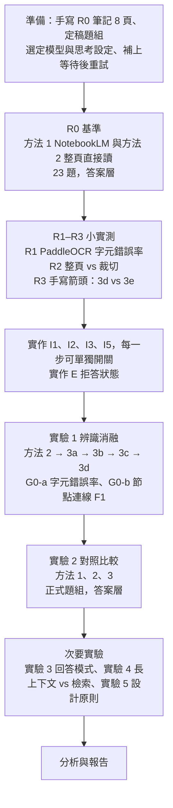

# NoteHandler 實驗架構

> 2026-09-21 重新產生，取代先前版本。整個研究的實驗設計：假設、比較的方法、變數、資料、指標的計算方式、流程、統計分析與效度威脅。
> 2026-11-02 補上第十一節：R0 基準、第一個提示詞實驗、多次辨識投票與開源模型比對的結果。
> 2026-11-09 補上 11.5–11.8：LLM 評審測試、易混字清單、更新的 Gemini、Claude Opus 5.5；標準稿修正兩字後，第十一節全部數字重算；更正 G0-a 的校正來源。
> 2026-11-09（下午）補上 11.9–11.10：切塊放大重讀、Claude Sonnet 5.5 與 Haiku 5.5、以語料庫詞頻客觀分類錯誤；標準稿再修正兩字（914 字），全部重算；「改成課本寫法」的主觀說法全部改掉。
> 專案總文件是 [專題總覽.md](專題總覽.md)（項目代號 R、I、G、E 沿用它）；文獻依據見 [文獻整理.md](文獻整理.md)。
> 本文件的「實驗 1–5」和總覽的產品項目 E（「筆記裡沒有」狀態）不同，請勿混淆。

---

## 一、研究問題與假設

**題目：** 手寫筆記的結構忠實辨識與可驗證問答。

**一句話：** 主張「**回答**比 NotebookLM 準」，並用「**辨識**比直接讀準」證明原因。

| 假設 | 內容 | 比較對象 | 角色 |
|---|---|---|---|
| **H1** | 疊加前處理、版面切割與裁切、多次辨識投票、圖形轉 Mermaid 等步驟，能提升**辨識正確率** | 方法 3 vs 方法 2 | 機制 |
| **H2** | 方法 3 的**回答正確率**高於 NotebookLM，尤其是箭頭、圖解題 | 方法 3 vs 方法 1 | **主要主張** |
| **H3** | H2 的差距來自辨識：方法 3 因「讀錯字、讀錯圖」而答錯的比例較低 | 各方法答錯的題目 | 連結 H1 與 H2 |

**前提（作者決定，2026-09-21）：**
- 所有量測都用系統**直接產生、未經人工修正**的辨識稿與答案。程式發現問題時自動重讀或投票，不交給使用者。
- 「使用者能不能發現錯誤」的使用者實驗暫停（總覽 G4）。
- 手寫注音不在研究範圍內（客群不同）。

---

## 二、比較的方法

| # | 方法 | 內容 | 看得到辨識稿？ |
|---|---|---|---|
| 1 | **NotebookLM** | 上傳原圖，分科開 notebook 直接問 | **否** |
| 2 | **整頁直接讀**（NoteHandler 目前做法） | 整頁一次送 Gemini 辨識，再用 NoteHandler 回答 | 是 |
| 3a | 2 ＋ **I1 前處理** | OpenCV 拉正、透視校正、提高對比 | 是 |
| 3b | 3a ＋ **I2 版面切割與裁切放大** | PP-StructureV3 或 MinerU 切出文字、公式、圖形區塊，逐塊放大送 Gemini | 是 |
| 3c | 3b ＋ **I3 多次辨識投票** | 每個文字區塊由 Gemini（整區、放大重讀）與 PaddleOCR 各讀一次，程式逐字投票 | 是 |
| 3d | 3c ＋ **I5 圖形轉 Mermaid（TextFlow 式）** | 圖形區塊 → Gemini 輸出 Mermaid＋座標 → 程式驗證，不合法就重新產生 | 是 |
| （3e） | 3c ＋ **I5 Arrow-guided 式** | 先偵測箭頭起訖點與節點、OCR 讀節點文字，連同座標交給 Gemini | 是；**3d 夠好就不做** |

- 3a → 3d 是**逐步疊加的消融序列**，每加一步量一次。
- 「方法 3」在假設中指序列的最後一步（3d，或做了的話 3e）。
- 3a–3c 的順序可依 R1、R2 的結果調整；在小實測中沒有幫助的步驟，仍保留在序列中量測，但不放進最終流程。
- 3e 的缺口：**手寫箭頭沒有現成的偵測器**（Arrow-Guided VLM 論文用的是印刷流程圖的偵測器）。替代方案是請 Gemini 回傳箭頭座標框（偵測仍交給 LLM，與 3d 差距變小），或訓練小型偵測器（總覽 X2，需自行標註）。

### 各方法能比的層級

| 指標層級 | 方法 1 NotebookLM | 方法 2、3 |
|---|---|---|
| 辨識層（字元錯誤率、節點／連線 F1） | **不能**：來源唯讀，看不到辨識稿 | 可以 |
| 答案層（正確率、幻覺、出處、拒答） | 可以 | 可以 |

**辨識層沒有外部對照組**，只能和方法 2 比。被問「NotebookLM 的字元錯誤率是多少」時，答案是「不知道，也沒有宣稱」。R0 時實際確認 NotebookLM 有無顯示辨識稿的介面；若有，只當補充數字。

---

## 三、變數

### 3.1 自變數

| 實驗 | 自變數 | 水準 | 總覽代號 |
|---|---|---|---|
| **實驗 1 辨識消融**（主實驗） | 辨識流程 | 方法 2、3a、3b、3c、3d（、3e） | G1 辨識層 |
| **實驗 2 對照比較**（主實驗） | 系統 | 方法 1、方法 2、方法 3 | G1 答案層 |
| 實驗 3 回答模式 | 回答提示詞 | P0 目前的版本（改寫）／P1 CP-Link（引用原句） | G5 |
| 實驗 4 長上下文 vs 檢索 | 送給模型的方式 | 整份送入／切塊檢索／依原順序檢索 | G2 |
| 實驗 5 設計原則消融 | 誰做判斷 | 程式核對出處 vs LLM 判斷；使用者選類別 vs 全部類別 | G3 |

實驗 1、2 是主實驗；實驗 3–5 是次要實驗，各自獨立進行，一次只改一個自變數。

### 3.2 控制變數

| 項目 | 固定為 | 狀態 |
|---|---|---|
| **辨識與回答模型** | 同一個 Gemini 模型與版本，全程不換 | **`gemini-3.1-flash-lite`**（2026-11-02 作者選定：產品預設，量的是使用者實際用到的版本） |
| **思考設定** | 開或關、思考 token 上限，全程固定 | 程式沒有設定，使用模型預設值。目前所有執行都相同，但未明確寫死；之後要改成明確設定 |
| 生成參數 | temperature 0 | 程式已是如此 |
| 辨識提示詞 | 同一版；3b 之後的逐區塊提示詞只多一句「這是一個區塊」，內容規則相同 | — |
| 回答提示詞 | 實驗 1、2 固定用 P0；只有實驗 3 改變 | — |
| 原始檔 | 同一批照片，同解析度、同檔名；一頁一張圖，不合成 PDF | — |
| 發問範圍 | 分科：NoteHandler 選該題所屬類別；NotebookLM 一科一個 notebook | — |
| 發問方式 | 題目原封不動、每題開新對話、只問一次 | — |
| 整份送出上限 | 60,000 字元（實驗 4 除外） | — |

**NotebookLM 的底層模型版本無法得知也無法固定**，寫進報告的限制。

### 3.3 執行穩定性

- 熱門模型在高峰時段常回 **503「需求過高」**（2026-09-21 實測：看圖時兩把金鑰各失敗一次、第三次才成功）。2026-11-02 的提示詞實驗也因此失敗兩次，第三次才跑完。
- `eval/r0/run_baseline.py` 已有**等待後重試**：等待時間逐次加倍（30、60、120 秒…），最多 6 次。重試不影響結果，只影響時間；一題最終仍失敗會記錄錯誤、不從資料中刪除；辨識失敗則整次執行中止，換新資料夾重跑。

### 3.4 應變數

見第五節「指標」。

---

## 四、資料

### 4.1 筆記

| 資料組 | 內容 | 狀態 | 用途 |
|---|---|---|---|
| **G0-a 真實筆記** | 6 份 PDF、66 頁，8 月由 **AI 校正**的辨識稿，不是作者逐字校對（`eval/g0/transcripts/`）；另有舊模型的整頁辨識結果（`eval/g0/baseline_gemini_whole_page.json`） | ✅ 已有 | 實驗 1 的**文字**部分（字元錯誤率） |
| **G0-b R0 筆記** | 8 頁、3 科（地科、生物、歷史），依 `eval/r0/手寫筆記稿.md` 手寫，含 4 頁箭頭或圖解（第 2、5、6、7 頁） | ✅ 已手寫（v3） | 實驗 1 的**圖形**部分（節點／連線 F1）、實驗 2 |
| G0-c 補充 | 更多含箭頭、圖解的真實筆記，最好來自不同組員 | ⬜ 視 R0 結果 | 擴大圖形部分與實驗 2 的樣本、增加筆跡來源 |

**注意：**
- G0-a 的校正稿為了舊實驗加上了 Markdown 標題，算字元錯誤率前先去掉（見 5.1 的正規化）。
- G0-a 的整頁辨識結果是 8 月用舊模型跑的，**正式實驗 1 要用選定的模型重跑**方法 2。
- G0-a 沒有箭頭題與結構標註。圖形部分主要靠 G0-b：它的**標準節點與連線已經定義在手寫筆記稿的【圖】區塊裡**，不需另外標註。
- 所有筆記、標準稿、標註、題組答案、掃描檔都**不進 git**（`.gitignore` 已設定）。

### 4.2 題組

每題有標準答案與所在頁碼，**在任何系統作答前定稿**，看過回答後不能修改。

| 類別 | 意思 | R0（G0-b） | 正式 |
|---|---|---|---|
| A 單頁文字題 | 單頁、看文字就答得出來 | 8 | 視 G0-a 補題 |
| B 跨頁題 | 需整合同一科的多頁 | 3 | 視 G0-a 補題 |
| C 看圖題 | 資訊只畫在圖上，要讀懂箭頭或圖解 | 8 | 隨 G0-c 增加 |
| D 筆記裡沒有 | 正確行為是說「筆記沒有提到」 | 4 | 同科、筆記沒寫的內容 |

- R0 的 23 題在 `eval/r0/題組與標準答案.md`（不進 git）。
- 外部的 235 題題組（對應 G0-a）可沿用，補上 C、D 兩類後當正式題組。
- C 類中答案本身是課本常識的題目（R0 的 C2、C3、C5、C6），要一併看出處是否指到圖所在的頁；答對但出處不對記為「可能未讀圖」。C1、C4、C7、C8 較依賴圖的細節。

---

## 五、指標與計算方式

### 5.1 辨識層（只有方法 2、3）

**字元錯誤率（CER）**，依 OmniDocBench／OCRBench v2 的編輯距離定義：

```
CER = 編輯距離(系統辨識稿, 標準稿) ÷ 標準稿字元數
```

- **逐頁計算**，報告整體（全部頁加總）與逐頁分布；另外分開報告**公式區**與**一般文字區**。
- **比較前兩邊做同樣的正規化**（寫成程式，兩邊一致套用）：
  - 去掉 Markdown 標題記號、清單符號、粗體記號
  - 去掉系統產生的固定句（「這是一份【科目】科的筆記」「關鍵字：」行、「## 第 N 頁」）
  - 全形與半形統一，空白與換行合併
  - LaTeX 只比較內容：例如 `$CO_2$` 與 `CO₂` 視為相同

**節點／連線 F1**，依 MindBench 的結構解析指標：

- **節點**：正規化後的文字，編輯距離 ≤ 1 個字，或在節點長度 20% 以內，視為同一節點（門檻事先定好，不看結果再調）。
- **連線**：有方向的三元組（起點, 終點, 箭頭上的文字）。起點與終點都對上才算對；箭頭文字另外報告正確率。
- **精確率** = 對的連線數 ÷ 系統輸出的連線數；**召回率** = 對的連線數 ÷ 標準連線數；F1 為兩者調和平均。
- 方法 2 沒有 Mermaid 輸出：由評分者依它的文字描述，整理出它「表達了哪些連線」再比對。這一步是人工判定，由兩位評分者各自做並計算一致性。

**其他記錄：** 每頁辨識時間、Gemini 呼叫次數、思考 token 數、503 重試次數、I5 重新產生的次數、I3 投票後仍決定不了的字數。

### 5.2 答案層（所有方法）

| 指標 | 定義 | 依據 | 計算方式 |
|---|---|---|---|
| 答案正確率 | 正確 ÷ 題數；「部分正確」另列 | — | 人工對照標準答案 |
| 沒有依據的句子比例 | 筆記沒寫或與筆記矛盾的句子 ÷ 全部句子；分「與資料矛盾」「資料以外的內容」 | RAGTruth、RAGAS Faithfulness 的定義 | 人工逐句判定 |
| 引用召回率 | 有出處、且出處內容支持的句子 ÷ 全部需要出處的句子 | ALCE | 人工 |
| 引用精確率 | 支持該句的出處 ÷ 全部出處 | ALCE | 人工 |
| 出處頁碼正確率 | 出處指到標準答案所在頁 ÷ 有出處的題數 | — | NoteHandler 程式比對；NotebookLM 人工讀它指到的段落 |
| 正確拒答率 | D 類中正確表示「筆記沒有」÷ D 類題數；另報 A–C 類的**錯誤拒答率** | — | NoteHandler 用拒答字串判斷（總覽 E）；NotebookLM 人工 |
| 複製程度（實驗 3） | 答案中能在送出的筆記裡找到逐字相同片段的字元比例 | Copy-Paste（ICLR 2026） | 程式 |
| **答錯原因**（H3） | 讀錯字／讀錯圖／推理錯／用了筆記外知識 | — | 方法 2、3 對照辨識稿**確認**；NotebookLM 只能從答案**推測**，備註註明 |

所有答案層指標都**依題型（A、B、C、D）分開報告**；H2 的重點是 C 類。

### 5.3 評分流程

- **不用 LLM 當評審**（位置偏誤，且違反設計原則）。人工標註或程式計算。
- 每個人工判定的欄位由**兩位評分者各自評分**，計算 Cohen's κ；κ < 0.6 的欄位先討論、修正判定規則，再重評。不一致的題目兩人討論決定，保留原始兩份評分。
- **盡量盲評**：去掉系統名稱、打亂順序後再評。出處格式不同（NotebookLM 與 NoteHandler 的標記長得不一樣），無法完全盲評，寫進限制。
- 判定規則（部分正確、沒有依據的句子、答錯原因）在看到任何答案前寫好，見 `eval/r0/題組與標準答案.md` 的「判定原則」。

---

## 六、實驗流程



| 階段 | 內容 | 產出 | 總覽代號 |
|---|---|---|---|
| 0 準備 | 手寫 G0-b；定稿 R0 題組；**選定並記錄模型與思考設定**；補上 503 等待後重試 | 8 張照片、定稿題組、設定紀錄 | G0 |
| 1 R0 基準 | NotebookLM 與目前的 NoteHandler 各答 23 題；確認 NotebookLM 有無顯示辨識稿的介面 | 兩份評分表；H2 的初步數字；最弱題型 | R0 |
| 2 小實測 | R1、R2、R3 | 決定 I1–I3、I5 的做法與順序 | R1–R3 |
| 3 實作 | I1、I2、I3、I5，每一步以設定開關；E 拒答狀態 | 可跑消融的辨識流程 | I、E |
| 4 實驗 1 | 方法 2 到 3d 逐步量測辨識層 | H1 的結果 | G1 |
| 5 實驗 2 | 正式題組上三個系統的答案層比較，含答錯原因 | H2、H3 的結果 | G1 |
| 6 次要實驗 | 實驗 3、4、5 | 回答模式、長上下文、設計原則的結果 | G5、G2、G3 |
| 7 報告 | 統計分析、限制 | 報告 | — |

**重複執行：** 2026-11-02 實測，`gemini-3.1-flash-lite` 在 temperature 0 下同一條件跑兩次，辨識稿的錯字與 23 題的答案**完全相同**（第十一節）。因此每個條件跑 **1 次**，並在每次換模型或換設定時加跑 1 次重複確認；若出現差異，再改為各跑 3 次、報告平均與範圍。NotebookLM 是手動操作，每題只問一次。

---

## 七、統計分析

| 比較 | 資料單位 | 檢定 | 報告 |
|---|---|---|---|
| 實驗 1 字元錯誤率：相鄰兩步（例如 3a vs 3b） | 每頁（配對） | Wilcoxon 符號等級檢定 | 差值中位數、bootstrap 95% 信賴區間 |
| 實驗 1 節點／連線 F1 | 每張圖（配對） | Wilcoxon；圖數少時只報信賴區間 | F1 與 bootstrap 95% 信賴區間 |
| 實驗 2 答案正確率：方法 3 vs NotebookLM | 每題（配對，對／錯） | McNemar 精確檢定 | 正確率差、不一致題數、95% 信賴區間 |
| 實驗 2 依題型 | 每題 | 同上，分 A–D 類 | C 類是重點 |
| H3 答錯原因 | 答錯的題目 | 比例與 Fisher 精確檢定 | 「讀錯字＋讀錯圖」占答錯的比例 |
| 多重比較 | 實驗 1 的多個相鄰步驟 | Holm 校正 | 校正後的 p 值 |

**樣本數：**
- R0 只有 23 題（C 類 8 題），**只能看出明顯差異和最弱的題型，不能下結論**。
- 正式實驗 2 的題數，依 R0 觀察到的「不一致題比例」估算 McNemar 需要的題數後再決定，避免重演舊研究線「可偵測的效果太大」的問題。
- 實驗 1 的文字部分有 66 頁，逐頁配對，樣本相對足夠；圖形部分頁數少，以信賴區間為主。

**事先寫好：** 假設、主要指標（H1：整體字元錯誤率與連線 F1；H2：C 類與整體答案正確率）、檢定方法、判定門檻，在跑實驗 1、2 之前寫進本文件，之後不依結果更改。

---

## 八、結果解讀

| 結果 | 解讀 | 接下來 |
|---|---|---|
| H1、H2 都成立 | 辨識變準，回答也比 NotebookLM 準 | 用 H3 確認差距來自辨識 |
| H1 成立、H2 不成立 | 辨識變準，但沒反映在回答上 | 檢查看圖題是否真的需要看圖、題目是否太簡單 |
| H1 不成立、H2 成立 | 贏過 NotebookLM，但不是靠辨識步驟 | 用實驗 3（回答模式）、實驗 5（出處核對等設計原則）找出原因 |
| 都不成立 | 疊加步驟沒有幫助 | 誠實的負面結果，寫進報告 |
| R0 顯示 NotebookLM 各類題都很準 | 手寫辨識對它不是問題 | 區別需轉向，先與指導老師討論 |
| 實驗 1 中某一步沒有幫助 | 該步驟不值得它增加的時間與呼叫次數 | 從最終流程移除，但保留量測結果 |

---

## 九、效度威脅與對策

| 威脅 | 說明 | 對策 |
|---|---|---|
| NotebookLM 看不到辨識稿 | 辨識層沒有外部對照組 | 辨識層只和方法 2 比；H2 只在答案層；R0 實際確認並記錄 |
| NotebookLM 模型版本不明、會更新 | 結果無法重現 | 記錄測試日期與方案；同一批題目在短時間內一次做完 |
| 模型用常識作答 | 看圖題可能沒讀圖也答對 | 同時看出處是否指到圖所在頁；另設依賴圖細節的題目 |
| 題組偏向我們的系統 | 題目由我們出 | 題組在任何系統作答前定稿；抄寫者先不看題目 |
| 評分者知道是哪個系統 | 評分偏誤 | 去掉系統名稱、打亂順序；兩人各自評、算 κ；出處格式無法隱藏，寫進限制 |
| G0-a 校正稿有額外標題 | 字元錯誤率被高估 | 比較前統一正規化 |
| G0-a 校正稿是 AI 校正的 | 從 Gemini 的辨識稿改起，漏改處會被當成正確，Gemini 偏高；若再用 Claude 當評審，對 Claude 也偏高 | 報告寫明；G0 結果只當參考，主要結論用 R0 |
| R0 標準稿由 Claude 起草 | 作者沒改到的地方就是 Claude 的讀法，對 Claude 有利；到 11-09 為止已找出並修正 4 處標準稿的錯 | 作者逐字校對；其他模型一致而與稿子不同之處，再請作者對照手寫確認（11.8）；報告寫明 |
| G0-a 舊的整頁辨識是舊模型 | 方法 2 基準不公平 | 用選定的模型重跑方法 2 |
| 模型或思考設定中途改變 | 前後結果不可比 | 開始前選定並記錄；中途若必須換，全部重跑 |
| 503 造成部分頁面失敗 | 缺漏的頁面讓結果偏差 | 等待後重試；最終仍失敗記為「辨識失敗」，不刪除 |
| 樣本小 | R0 只有 23 題、圖形頁少 | R0 只當初步結果；正式題組依 R0 估算題數；圖形部分以信賴區間為主 |
| 同一位作者的字跡 | 結論可能只適用這個人的字 | 請不同組員各寫一部分（G0-c）；報告寫明筆跡來源數 |
| Gemini 隨機性 | 同條件重跑結果不同 | 方法 2、3 各跑 3 次，報告範圍 |
| 多次比較 | 實驗 1 有多個相鄰步驟 | Holm 校正 |
| 資料外洩 | 筆記與答案是私人資料 | 不進 git；NotebookLM 只上傳作者本人或已同意者的筆記 |

---

## 十、產出與檔案

| 檔案 | 內容 | 進 git |
|---|---|---|
| `handoff/實驗架構.md` | 本文件 | 是 |
| `handoff/專題總覽.md` | 專案總文件（研究主張、進度、技術參考） | 是 |
| `eval/r0/手寫筆記稿.md` | G0-b 的筆記內容與畫圖說明（含標準節點與連線） | 是 |
| `eval/r0/題組與標準答案.md` | R0 題組、標準答案、評分表、判定原則 | 否 |
| `eval/r0/*.jpg`、`eval/r0/results/` | 手寫照片與評分結果 | 否 |
| `eval/g0/transcripts/` | G0-a 的 66 頁 AI 校正稿 | 否 |
| `eval/g0/baseline_gemini_whole_page.json` | G0-a 的舊模型整頁辨識結果（參考用；正式實驗重跑） | 否 |
| `eval/r0/標準辨識稿.md` | 8 頁的逐字標準稿（Claude 起草、作者逐字校對，檔頭有修改紀錄），含 4 張圖的節點與箭頭表 | 否 |
| `eval/r0/關鍵事實.md`、`關鍵事實.sha256.txt` | 每題答對必須出現的事實、不可出現的詞、證據頁；定稿雜湊與修改紀錄 | 否 |
| `eval/r0/NotebookLM_提問單.md` | NotebookLM 的設定、題目與回答紀錄 | 否 |
| `eval/r0/run_baseline.py` | 用 App 本身的函式上傳 8 頁、問 23 題，存辨識稿與回答 | 是 |
| `eval/r0/score.py` | 答案層判定、字元錯誤率、三條「沒有依據的內容」規則與其錯誤注入驗證 | 是 |
| `eval/r0/compare_runs.py` | 多次執行並排比較，列出每次讀錯的字 | 是 |
| `eval/r0/run_vote.py` | 每頁讀 N 次、逐字投票，量投票後的錯字與「不一致＝可疑」的找錯能力 | 是 |
| `eval/r0/run_qwen.py` | 打包提示詞與掃描圖到租用 GPU、用 Qwen3-VL 讀圖、回本機與 Gemini 比對評分 | 是 |
| `eval/r0/run_claude.py` | 用 Claude API 讀 8 頁，與 Gemini、Qwen 比對，並算三模型多數決 | 是 |
| `eval/r0/judge_test.py` | 用規則造測試答案，比 LLM 評審與機械判定 | 是 |
| `eval/r0/confusable_flag.py` | 從 G0 挖易混字對，在 R0 測找錯能力 | 是 |
| `eval/r0/ping_gemini.py` | 每次對話由 hook 在背景 ping 3.7、3.8 Flash，能用時通知執行 R0 | 是 |
| `eval/r0/run_tiles.py` | 在空白行切塊、放大、分別讀再接起來 | 是 |
| `eval/r0/sinica_freq.py`、`classify_errors.py` | 查中研院平衡語料庫詞頻（有快取）；依規則分類每個錯字 | 是 |
| `eval/r0/compare_ngram.py`、`compare_wordfreq.py` | 同一批詞對查 Google Books Ngram（簡體）與 wordfreq | 是 |
| 之後新增 | 連線 F1 的計算程式、消融執行程式 | 程式進 git，結果不進 |

**時程粗估：** 準備與 R0 約 1–2 天；小實測約 1 天；實作 I1–I5 約 5–7 天；實驗 1、2 約 3–5 天（含人工評分）；次要實驗約 2–3 天。

**開始前需要作者決定：** 思考設定要明確寫死成什麼值、筆跡來源（是否請其他組員手寫）。實驗模型已定為 `gemini-3.1-flash-lite`。

---

## 十一、已完成的實驗（2026-11-02、11-09）

> 2026-11-09 標準稿兩次各修正兩字（見 11.8、11.9），本節數字已全部用修正後的稿子重算（914 字）。錯誤的分類一律用 11.10 的語料庫規則，不再用「課本寫法」這種主觀說法。

### 11.1 R0 基準：NoteHandler vs NotebookLM

**條件**

| 項目 | NoteHandler | NotebookLM（已改名 Gemini Notebook） |
|---|---|---|
| 原始檔 | `R0_p1.jpg`–`R0_p8.jpg`（手寫 v3，250 DPI） | 同一批檔案 |
| 分科 | 地科 p1–3、生物 p4–6、歷史 p7–8，每題在所屬類別問 | 三個 notebook，一科一個 |
| 模型 | `gemini-3.1-flash-lite`，temperature 0，整份送出（R0 每科只有幾百字，不經過分塊與檢索） | 不公開（第三方資料：2026-06 起為 Gemini 3.5） |
| 指示 | App 的 `PROMPT_TEMPLATE` | 自訂指示，逐條改寫自同一份 `PROMPT_TEMPLATE` |
| 日期 | 2026-11-02，`eval/r0/run_baseline.py` 自動執行 | 2026-11-02 全部 23 題重問（9 月先問的 13 題中抽 A7 重問，事實與 9 月一致） |

**評分標準先定稿再看回答：** `關鍵事實.md` 在 NoteHandler 回答產生前寫完並記下雜湊。之後只改過一處（B2 證據頁照題組補上 p5），也是在看到 NoteHandler 回答之前，修改紀錄在 `關鍵事實.sha256.txt`。

**答案層（`score.py` 機械判定）**

| 系統 | A | B | C | D 拒答 | 合計正確 | 出處正確 |
|---|---|---|---|---|---|---|
| NotebookLM | 7/8 | 3/3 | 8/8 | 4/4 | 22/23 | 21/23 |
| NoteHandler | 7/8 | 3/3 | 8/8 | 4/4 | 22/23 | 23/23 |

- 兩邊都只錯 A7，**錯誤來源不同**：
  - NotebookLM 把筆記的「聖安德烈斯」改成另一種譯名「聖安地列斯」。
  - NoteHandler 的辨識稿讀成「聖安德**里**斯」，這個錯從辨識階段一路傳到答案。這是第一個從頭追到尾的錯誤傳遞案例。
- NotebookLM 出處有錯頁的是 A4、A5：多引了跟答案無關的 p4 或 p5。
- **答案層接近滿分，R0 的題目分不出兩個系統的差異。** 要比較就得看辨識層，以及下面「沒有依據的內容」。

**辨識層（只有 NoteHandler）：** 對照標準稿的「文字」段，不計標點，漏字加錯字 **13/914（1.4%）**。

| 錯誤類型 | 例子（筆記 → 辨識稿） | 個數 |
|---|---|---|
| 換成另一個詞 | 蒸氣→蒸汽（3 次）、史蒂文生→史蒂芬生、獸力→畜力、水份→水分（往高頻或往低頻見 11.10） | 6 |
| 讀錯或漏字 | 聖安德烈斯→聖安德里斯、漏「美國」「才」「之」 | 其餘 |
| 改掉筆者的筆誤 | 主要成分時纖維素→為 | 1 |

**沒有依據的內容（三條確定性規則，`score.py`）**

所有規則都對照**手打的標準稿**，不對照系統自己的辨識稿；兩個系統套用同一套規則，重跑結果相同。

| 規則 | 量什麼 | NotebookLM | NoteHandler | 錯誤注入驗證：壞句抓到／好句誤報 |
|---|---|---|---|---|
| 1 圖的關係 | 回答說「X 導致 Y」，標準稿有沒有 X 到 Y 的箭頭或路徑 | **1**（B3：都市化→勞工問題） | 0 | 159/159、0/38 |
| 3 屬性 | 血液種類、節點文字顏色是否與標準稿矛盾 | 0 | 0 | 8/8、0/8 |
| 2 筆記外用詞 | 回答中不屬於筆記用詞的字所占比例 | 13.5% | 8.1% | 12/12、6/19 |

- 規則 2 會標記「意思對、措辭不同」的句子，6/19 的誤報就是這個原因。所以它量的是**沒有沿用筆記原文用詞的程度**（照抄程度的反面），不是幻覺本身。
- 規則 1 只認得標準稿裡的節點名稱；回答換了說法的節點不會被檢查，只會漏抓、不會誤報。

### 11.2 提示詞實驗 F3b：明確要求「照原樣寫」能不能減少把字換成另一個詞

**改了什麼：** 只改圖片辨識提示詞第 5 條，其他條件不變。

| | 第 5 條 |
|---|---|
| 原本 | 盡量保留原文的關鍵用語與數據，以便後續能據此回答細節問題。 |
| F3b | 照筆記上實際寫的字記錄，包括專有名詞、譯名與數據；即使和課本或常見寫法不同，也照原樣寫，因為後續會根據這份文字回答使用者關於自己筆記的問題。 |

**結果**（`compare_runs.py`）

| 執行 | 漏/錯字 | 換成另一個詞：往高頻／往低頻（11.10） | 答案正確 | 答錯的題 | 筆記外用詞 |
|---|---|---|---|---|---|
| baseline | 13/914（1.4%） | 3／3 | 22/23 | A7 | 8.1% |
| baseline 重跑 | 13/914（1.4%） | 3／3 | 22/23 | A7 | 8.1% |
| F3b | 12/914（1.3%） | 1／4 | 21/23 | A7、B2 | 8.8% |

- **baseline 重跑完全相同**：錯的字和 23 題答案都一樣。所以 F3b 的每個差異都可以歸因於提示詞。
- **換成另一個詞的錯沒有減少，只換了組合。** 水份→水分不再出現，卻多了聖安德烈斯→聖安**地列**斯，其他照舊。
- **A7 的錯誤類型改變**：從讀錯字（德里）變成另一種譯名（地列），跟 NotebookLM 一樣。
- **F3b 少錯的 1 字是筆誤「時」**：只有 F3b 照寫，其他讀法都改成「為」或「是」（見 11.8）。
- **B2 多錯一題**：辨識稿把「粒線體」讀成「粒**腺**體」，錯誤傳到答案。這個字手寫上本來就模稜兩可，屬於邊界案例。

**結論：** 光在提示詞裡要求「照原樣寫」，擋不住模型把字換成另一個詞。提示詞已改回原本的版本。這個結果說明，需要提示詞以外的方法（例如多次辨識比對、裁切後重讀可疑的字）。

**結果檔案：** `eval/r0/results/baseline/`、`baseline_r2/`、`prompt_f3b/`，各含 `transcripts/`、`answers.json`、`answers.md`、`meta.json`（模型、提示詞全文與雜湊、git commit）、`score.md`。

### 11.3 多次辨識投票：同一個模型讀 5 次，逐字多數決

**做法：** 每頁用同一個模型、同一份提示詞讀 5 次，溫度改成 0.7（溫度 0 時每次結果相同，沒有東西可投）。溫度只在 `eval/r0/run_vote.py` 這個程式裡改，App 本身不變。5 次讀法中跟其他 4 次最像的一次當基準，其他 4 次對齊後逐字投票，同票時保留基準的字。5 次讀法不一致的位置標為「可疑」，這一步不需要標準稿，所以也順便測它能不能當自動找錯工具。

**結果**（`eval/r0/results/vote_t07/vote.md`）

| | 漏/錯字 |
|---|---|
| 單次讀，溫度 0（baseline） | **13/914（1.4%）** |
| 單次讀，溫度 0.7（5 次各自） | 19、13、19、19、18（1.4%–2.1%） |
| 5 次投票後 | 16/914（1.8%） |

- **投票後反而比溫度 0 的單次讀差。** 調高溫度讓每次讀都多出錯字，投票只救回其中一部分。
- **錯誤以「穩定的錯」為主：** 5 次都錯在同一個字的有 8 字，正是 baseline 一直出現的那些：蒸氣→蒸汽（3 次）、史蒂文生→史蒂芬生、聖安德烈斯的「德烈」，以及漏掉的「才」「之」。每次都錯得一樣，投票只會再確認一次。另有 22 字是「有時錯、有時對」的不穩定錯誤。
- **「不一致＝可疑」當找錯工具很弱：** 被標成可疑的 22 字只有 3 字真的讀錯（精確率 14%）；真正讀錯的 11 字只抓到 3 字（召回率 27%）。原因同上：穩定的錯 5 次都一樣，不會被標記。
- 計算精確率與召回率時，只算能逐字對齊到標準稿「文字」段的字。圖的文字描述不在標準稿的「文字」段，對齊時會變成一大段不等長的替換，不列入。

**結論：** 提示詞（11.2）和同一個模型多次投票（11.3）都修不好這些錯，因為它們是**模型的固定習慣**：換成另一個詞、省略虛詞。下一步是換一個習慣不同的模型做比對或投票，例如開源的 Qwen2.5-VL：一個模型把「蒸氣」改成「蒸汽」時，另一個未必會改。

**結果檔案：** `eval/r0/results/vote_t07/`，含 `reads/`（每頁 5 份辨識稿）、`meta.json`（模型、溫度、git commit）、`vote.md`。

### 11.4 換一個模型：開源 Qwen3-VL-8B 與 Gemini 比對

**做法：** 用開源的 `Qwen/Qwen3-VL-8B-Instruct`（原精度，未量化）讀同樣 8 頁，提示詞是 App 的圖片辨識提示詞原文（`eval/r0/run_qwen.py --bundle` 直接從 `rag_core.py` 擷取，雜湊 `b08e58e4`）。本機顯示卡只有 4 GB 放不下，改租 gputw.ai 的 RTX 3090 24GB，約 40 分鐘、約 NT$8；租用機器上只有腳本、提示詞與 8 張掃描圖，沒有 App 程式碼與金鑰。每頁溫度 0 讀 1 次，再用溫度 0.7（top_p 0.95、top_k 20，同 Gemini）讀 5 次。

**結果**（`eval/r0/results/qwen_out/score.md`）

| | Gemini | Qwen3-VL-8B |
|---|---|---|
| 單次讀，溫度 0 | **13/914（1.4%）** | 17/914（1.9%） |
| 5 次投票後 | 16/914（1.8%） | 18/914（2.0%） |
| 5 次都錯的「穩定的錯」 | 8 字 | 9 字 |

- **兩個模型的錯大多不同：** 溫度 0 時兩邊錯在同一個標準字的只有 **3 字**：獸力→畜力、蒸氣→蒸汽（3 處中的 1 處）、筆誤「時」→為。
- **Gemini 錯、Qwen 對：** 聖安德烈斯（A7 錯誤的源頭）、漏「美國」、史蒂文生的「文」（Qwen 錯在「生」→「森」）、另外 2 處蒸氣。
- **Qwen 自己的錯：** 粒線體→粒腺體、瓣膜→韌帶、7→9、「通常」→「近帶」等，比較像真的看錯字形，讀出的字串多半不是詞（11.10 的「非詞替換」）。
- **Qwen 自己投票也沒有變好**（1.9% → 2.0%），和 Gemini 一樣。

**「兩個模型讀法不同＝可疑」當找錯工具（找 Gemini 的錯）**

| 找錯方法 | 精確率 | 召回率 |
|---|---|---|
| Gemini 自己讀 5 次，不一致＝可疑（11.3） | 14%（3/22） | 27%（3/11） |
| **Gemini 對照 Qwen，不一致＝可疑** | **26%（5/19）** | **62%（5/8）** |

召回率的分母不同（11 與 8），因為只算能逐字對齊到標準稿的字，對齊方式依比對的讀法而定。

**結論：** 錯誤是模型的固定習慣：同一個模型讀再多次、改提示詞都修不好（11.2、11.3），換一個模型才看得到。跨模型比對能標出 Gemini 一半以上的讀錯，但兩個模型**共同的錯**（畜力、蒸汽、筆誤「時」→為）仍然抓不到。

**結果檔案：** `eval/r0/results/qwen_out/`，含 `t0/`（溫度 0 辨識稿）、`reads/`（每頁 5 份）、`meta.json`（模型、GPU、套件版本、提示詞雜湊）、`log.txt`、`score.md`。

### 11.5 LLM 評審 vs 機械判定：LLM 評審會不會把相似字判成正確

**做法**（`eval/r0/judge_test.py`，2026-11-02）：評審模型 `gemini-3.1-flash-lite`，溫度 0。測試答案全部用規則產生，不用模型寫：

| 答案類型 | 怎麼產生 | 應判 | 題數 |
|---|---|---|---|
| 標準答案 | 標準答案原文 | 正確 | 23 |
| 相似字 | 關鍵事實裡換一個字，字對取自模型實際讀錯過的字（出現 ≥ 2 次，虛詞不換） | 不是正確 | 12 |
| 刪事實 | 刪掉一個關鍵事實的每一次出現 | 部分 | 33 |
| 真實回答 | NotebookLM、NoteHandler、F3b 的 69 題回答 | 和機械判定比 | 69 |

評審提示詞兩種：**一般**＝「意思和標準答案相符就算正確」（常見寫法）；**嚴格**＝「正確是指和使用者的筆記一致，專有名詞、譯名、數字、用字不同就算錯，即使是課本寫法」。

**結果**（`eval/r0/results/judge_test/report.md`）

| 答案類型 | 機械判定 | LLM（一般） | LLM（嚴格） |
|---|---|---|---|
| 標準答案（應判正確） | 23/23 | 22/23 | 22/23 |
| **相似字（不應判正確）** | 11/12 | **3/12** | 10/12 |
| 刪事實（應判部分） | 32/33 | 28/33 | 26/33 |

- **一般評審把 12 題相似字中的 9 題判成正確**，例如粒線體→粒腺體、聖安德烈斯→聖安德列斯、共產黨宣言→至產黨宣言、土地→土德。
- **一般評審在真實回答上和機械判定只差 4 題，正好是 3 個 A7 錯誤與 F3b 的 B2 錯誤，全部判成正確。** 也就是說，用常見寫法的 LLM 評審，研究中唯一完整追到的錯誤傳遞鏈（A7）會直接消失。這是老師要求的「相似詞誤判分析」的實測數據。
- **嚴格評審**抓到 10/12 的相似字（仍放過起始點→起始處、液胞→液泡），但真實回答只有 56/69 和機械判定一致，主要是把措辭不同的正確拒答（D1、D3、D4）判錯。
- **嚴格評審也指出機械判定的盲點**：A6 三個系統都寫「在地表**下**緩慢冷卻」，機械判定因為字串裡有「地表」就給正確；NoteHandler 的 B3 兩個關鍵詞都有出現，但主要對應項答錯。機械判定另有兩個子字串問題：「NADP」含有「ADP」、重複出現的詞只看第一次。

**結論：** 機械判定抓得到用字、抓不到意思；LLM 評審抓得到意思，但常見寫法會放過相似字。兩者盲點互補。建議以機械判定為主，嚴格 LLM 評審意見不同的題目列為「爭議」，不由人或另一個 LLM 裁決。`關鍵事實.md` 是事先定稿的，A6 的評分規則目前**沒有**改，列為已知的機械判定盲點。

### 11.6 易混字清單：從 G0 挖字對，在 R0 測試

**做法**（`eval/r0/confusable_flag.py`）：把 G0 的校正稿和 Gemini 8 月的整頁辨識稿對齊，挖出「筆記寫 a、模型寫 b」且出現 ≥ 2 次的字對，再把 R0 辨識稿裡所有 b 標成可疑。R0 沒有參與挖字對。

**結果**（`eval/r0/results/confusable_flag.md`）：挖出 14 組，主要是个→個、会→會、变→變（筆記寫簡體或速寫，模型改成標準繁體）。

| 方法 | 標記字數 | 抓到 | 精確率 | 召回率 |
|---|---|---|---|---|
| 易混字清單 | 35 | 0/9 | 0% | 0% |
| Gemini 對照 Qwen（11.4） | 19 | 5/9 | 26% | 56% |

**結論：** G0 也有「筆記寫簡體或速寫、模型改成繁體正字」的現象，但實際的字對因人、因筆記而異，從一份筆記挖出的清單套不到另一份。若要用清單，必須用通用的（例如教育部異體字表、OpenCC）。

### 11.7 換更新的 Gemini：Gemini 3 Flash（3.7、3.8 Flash 尚無法使用）

**動機：** 文獻（Lee 等，2026，《Do VLMs Read or Rewrite?》，FaithC4）測了 15 個模型，Gemini-3-Flash 幾乎不改寫擾動過的文字。但它的擾動是不成詞的亂字與形近字，筆記裡的則是**合法、但不是模型最熟悉的寫法**。

**做法：** `eval/r0/run_baseline.py --model gemini-3-flash-preview`，其他條件與 baseline 相同（辨識與回答都換成 3 Flash）。

| | 3.1 Flash Lite（baseline） | 3 Flash |
|---|---|---|
| 漏/錯字 | 13/914（1.4%） | 13/914（1.4%） |
| 換成另一個詞：往高頻／往低頻（11.10） | 3／3 | 2／6 |
| 照常識改寫內容 | — | 2（速度較快→**最**快；蒸氣機**普及**→蒸汽機**改良**） |
| 答案正確（機械判定） | 22/23 | 20/23（A7、B2、C1） |

- **換成另一個詞的錯沒有減少**，往低頻的反而更多，還多了兩處依常識改寫內容；「普及→改良」連意思都變了（瓦特改良蒸汽機的常識）。
- **B2 是第二條完整追到的錯誤傳遞鏈**：辨識稿讀成「粒腺體」，答案跟著錯。A7 讀成「聖安德列斯」。
- **B3 讀成「都市化→勞工問題」**，和 NotebookLM 的錯完全相同（NotebookLM 底層也是 Gemini）。
- **C1 是評分程式誤判**：回答先寫結果（變質岩）再寫條件（高溫高壓），機械判定只看第一次出現的位置就判順序錯；實際答對，所以實際是 21/23。規則 1 在 C5、C6 標出的「O₂→CO₂」是誤報（回答在講氣體交換）。這兩處都沒有修改評分規則，列為已知盲點。
- **3.7、3.8 Flash：** 2026-11-09 兩把金鑰都在伺服器端逾時（504），無法測試。之後每次對話自動 ping（`eval/r0/ping_gemini.py`），能用時再跑。

**結論：** 換更新的 Gemini 沒有減少「換成另一個詞」的錯。文獻中 Gemini-3-Flash 對亂字的穩定性，不能推到合法的變體寫法上；這一類是現有 benchmark 沒測到的錯誤。

### 11.8 Claude Opus 5.5，與標準稿的修正

**做法**（`eval/r0/run_claude.py`，2026-11-09）：`claude-opus-5-5` 讀同樣 8 頁，提示詞與 Gemini、Qwen 相同（雜湊 `b08e58e4`）。Claude API 不能設定溫度、不能關閉思考，所以 effort 固定為 `medium`，每頁讀 1 次。**刻意不開拒答時改用其他模型（fallback）**，以免不同模型混在同一個條件裡；8 頁都正常回答。用量：輸入 37,344、輸出 7,514 token（含思考），約 US$0.30。

**標準稿的偏誤與修正：** R0 標準稿是 2026-09-21 由 Claude 看圖起草、作者逐字校對的，作者沒改到的地方就是 Claude 的讀法，對 Claude 有利。因此列出「Gemini 與 Qwen 讀法相同、只有 Claude 與標準稿一致」的 4 處，請作者對照手寫確認：
- p4「只有植物行光合作用**的**cell才有」：v3 手寫已刪掉「的」，稿子漏改 → **刪去**。
- p4「植物cell壁的主要成分**是**纖維素」：手寫寫的是「**時**」，是作者寫的時候的筆誤 → 依校對規則 1「寫錯的字照原樣保留」**改為「時」**。
- p7「獸力」、p8「蒸氣」：確認無誤。

修改是在看過結果之後做的，紀錄寫在標準稿的檔頭。標準字數從 916 變成 915，**本節以前的所有數字都已用修正後的稿子重算**。修正讓 Claude 多錯 1 字（「時」原本算 Claude 對），所以這次修正對 Claude 更不利。

**結果**（`eval/r0/results/claude_opus55/score.md`）

| 模型 | 漏/錯字（914 字） | 換成另一個詞：往高頻／往低頻（11.10） | 筆誤「時」讀成 |
|---|---|---|---|
| Gemini 3.1 Flash Lite | 13/914（1.4%） | 3／3 | 為 |
| Gemini 3 Flash | 13/914（1.4%） | 2／6 | 是（「成分」也改成「成份」） |
| Qwen3-VL-8B | 17/914（1.9%） | 5／2（另有 6 個非詞） | 為 |
| **Claude Opus 5.5** | **5/914（0.5%）** | **3／0** | 是 |
| 三模型逐字多數決 | 8/914（0.9%） | — | — |

- **Claude 讀對了另外兩個模型都改掉的字**：蒸氣（3 處）、獸力、史蒂文生、聖安德烈斯。Claude 的 5 個錯：乃→是、份→分、時→是，漏「才」「的」。
- **筆誤「時」，四個讀法有三個悄悄改成正確的字**，只有 F3b（提示詞要求照原樣寫）照寫「時」。這是 FaithC4 所說「把不完美的文字改寫成合理形式」在真實筆記上的例子，也是 F3b 唯一的正面效果。
- **三模型評審團**多數決後 0.9%，比 Claude 單獨讀差，因為 Gemini 和 Qwen 常常一起錯。「三個模型讀法不一致＝可疑」：精確率 21%（5/24）、召回率 100%（5/5），但只有 5 個錯，樣本太小。

| 找錯方法 | 精確率 | 召回率 |
|---|---|---|
| Gemini 自己讀 5 次（11.3） | 14%（3/22） | 27%（3/11） |
| Gemini 對照 Qwen（11.4） | 26%（5/19） | 62%（5/8） |
| 三個模型對照 | 21%（5/24） | 100%（5/5） |

**結論：** 把字換成另一個詞是大型視覺語言模型的通病，但程度差很多：改提示詞、同模型投票、換更新的 Gemini 都修不好，換成 Claude Opus 5.5 則錯字從 13 降到 5。限制要寫清楚：R0 只有 914 字、一位作者的字跡，標準稿由 Claude 起草（已做上述檢查，但沒改到的地方仍可能偏向 Claude），Claude 也比 Gemini 3.1 Flash Lite 貴得多（每頁約 US$0.04）。

### 11.9 切塊放大重讀，與 Claude Sonnet 5.5、Haiku 5.5

**標準稿第二次修正：** 4 個模型 × 整頁／切塊 共 8 組讀法，在 p1 兩處全部和標準稿不同、彼此一致：「轉形斷層」（全部讀成「轉型」）、「陸陸碰撞擠形成」（全部沒有「擠」）。作者對照手寫，兩處都是**標準稿打錯**（手寫就是「轉型」、沒有「擠」），已修正，標準字數 915 → 914，**第十一節所有數字已重算**。所以「轉形→轉型」從來不是模型的錯，11.1–11.4 早先把它算成模型錯誤的說法已刪除。到目前為止，用「其他讀法一致、只有標準稿不同」找出的 6 處中，4 處確實是標準稿錯。

**做法**（`eval/r0/run_tiles.py`）：在空白行把每頁切成橫向文字帶（每條至少 300 px，不切斷任何一行；p6 整頁是一張圖，沒有切），每條放大 2 倍後單獨讀，再依序接起來。8 頁共 20 條。提示詞、模型設定與整頁讀相同（Gemini 經過 App 的 `describe_image`，Claude 用同一份提示詞、effort `medium`）。另外用 `run_claude.py` 讓 Sonnet 5.5、Haiku 5.5 整頁讀。

**結果**（`eval/r0/results/_compare_1109.md`）

| 模型 | 整頁讀 | 切塊放大讀 | 8 頁費用（整頁 → 切塊） |
|---|---|---|---|
| Gemini 3.1 Flash Lite | 13/914（1.4%） | 11/914（1.2%） | — |
| **Claude Opus 5.5** | **5/914（0.5%）** | **5/914（0.5%）** | US$0.30 → 0.56 |
| Claude Sonnet 5.5 | 10/914（1.1%） | 8/914（0.9%） | US$0.13 → 0.24 |
| Claude Haiku 5.5 | 47/914（5.1%） | 39/914（4.3%） | US$0.01 → 0.02 |

- **切塊減少的是漏字與看錯字**：Gemini 讀回漏掉的「美國」、不再把「烈」讀成「里」、照寫筆誤「時」；Opus 讀回「的」、不再把「乃」讀成「是」。
- **切塊沒有減少換成另一個詞的錯，有時反而增加**：Gemini 與 Opus 切塊後都出現「聖安德烈斯→聖安**地列**斯」，Gemini 多了「液胞→液**泡**」。專有名詞與常用詞，上下文變少後照樣被換掉，符合 FaithC4「表示接近熟悉的詞就會改寫，與上下文多寡無關」的機制。
- **Opus 切塊沒有改善**（5 → 5）；四個模型往同一方向改善，但每個只差 0–8 字，不能算證明。
- **Haiku 5.5 不適合讀筆記**：錯字率高，還會改寫內容（「花崗」→「大深成」、「time」→「時間」）。

**結論：** 換模型的效果遠大於切塊。Opus 整頁讀在 R0 只剩 5 個錯，R0 已經分不出方法的好壞，之後要比較方法，需要更大的測驗（例如合成的筆記版 FaithC4）。

### 11.10 錯誤的客觀分類：中研院平衡語料庫與 Google Books Ngram

先前把「蒸氣→蒸汽」這類錯稱為「改成課本寫法」，那是主觀判斷，已全部改成下面依規則判定的分類。

**做法**（`eval/r0/classify_errors.py`，詞頻查詢 `eval/r0/sinica_freq.py`）：詞頻取自**中央研究院現代漢語平衡語料庫 4.0**（台灣繁體，1981–2007 年，約 1,100 萬詞）的免費線上查詢；完整詞頻表由 ACLCLP 授權販售，沒有購買。每個替換錯字往前後各取最多 3 個字，找出「標準稿寫法或讀出的寫法至少一邊是語料庫中的詞」的最長字串，比較兩邊的筆數：

| 分類 | 條件 |
|---|---|
| 往高頻替換 | 讀出的寫法比標準稿的寫法常見 |
| 往低頻替換 | 讀出的寫法較少見 |
| 非詞替換 | 讀出的寫法不在語料庫中 |
| 證據不足 | 兩邊都少於 5 筆（門檻是看過第一次結果後才定的） |
| 刪除 | 漏字 |

「非詞」與「真詞」錯誤是拼字錯誤研究的既有分類（Kukich, 1992）。線上查詢最多回報 20,000 筆，「是」「的」「與」等常用字都停在 20,000。

**結果**（`eval/r0/results/error_classes.md`，錯的標準字數）

| 讀法 | 往高頻 | 往低頻 | 非詞 | 證據不足 | 刪除 | 合計 |
|---|---|---|---|---|---|---|
| Gemini 3.1 Flash Lite 整頁 | 3 | 3 | 0 | 2 | 4 | 12 |
| Gemini 3 Flash 整頁 | 2 | 6 | 0 | 2 | 1 | 13 |
| Qwen3-VL-8B 整頁 | 5 | 2 | 6 | 1 | 2 | 17 |
| Claude Opus 5.5 整頁 | 3 | 0 | 0 | 0 | 2 | 5 |
| Claude Sonnet 5.5 整頁 | 6 | 1 | 0 | 2 | 1 | 10 |

（合計少於 11.9 的總錯字數，是因為長度超過 4 字的替換不分類。）

- **我先前的主觀判斷有錯**：「史蒂文生→史蒂芬生」（6 → 2 筆）、「蒸氣機→蒸汽機」（9 → 2 筆）在台灣語料庫是**往低頻**，不是改成常見寫法。
- **Claude 的替換幾乎都往高頻**（水份→水分、乃→是、定義→意義、時→是）；**Gemini 一半往低頻**；**Qwen 多半是非詞**（起始點→起始處、通常→近帶），也就是真的看錯字形。

**台灣與大陸用法對照**（`eval/r0/compare_ngram.py`）：把同一批詞對用 OpenCC 轉成簡體，查 Google Books Ngram 簡體中文語料（id 34，經測試回傳中文資料，推定為 Chinese 2019；1980–2019 年平均頻率，少於 40 次不收錄）。另試過 wordfreq（`compare_wordfreq.py`），但它先斷詞，台灣寫法（蒸氣機、史蒂文生）都被拆開，無法比較，不採用。

| 詞對（筆記 → 讀成） | 中研院（台灣） | Ngram（大陸簡體） | 誰這樣讀 |
|---|---|---|---|
| 蒸氣機 → 蒸汽機 | 9 → 2，台灣較常用「蒸氣機」 | 3.5e-8 → 2.5e-6，大陸常用「蒸汽機」，約 70 倍 | Gemini 全部 4 種讀法 |
| 獸力 → 畜力 | 1 → 2，證據不足 | 「兽力」未收錄，「畜力」1.1e-6 | Gemini 全部 4 種讀法、Qwen |

**結論：** 「換成另一個詞」分成兩種。**往兩地都常見的詞換**是所有模型都有的；**往大陸用法換**（蒸氣機→蒸汽機、獸力→畜力）只出現在 Gemini（獸力→畜力 Qwen 也有），Claude 沒有。這可能是 Gemini 在台灣筆記上錯得多的一個原因，但目前只有 2 組詞，只能當假設。之後合成測驗的詞對，可以用這兩個語料庫客觀挑出「台灣與大陸用法不同」的詞。單字比較（胞／泡、錯開／錯動）在兩個語料庫給出相反方向，不可靠。

**引用：** 詞頻來自中央研究院平衡語料庫（CKIP，中央研究院），論文中需註明。
