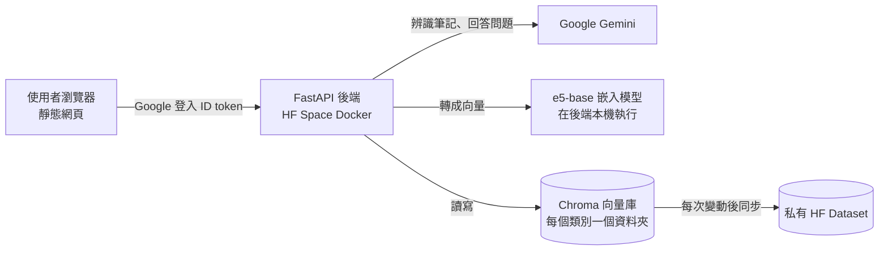
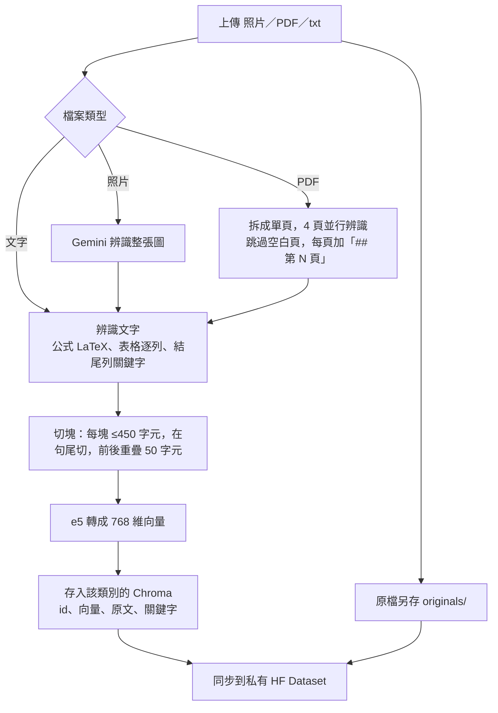
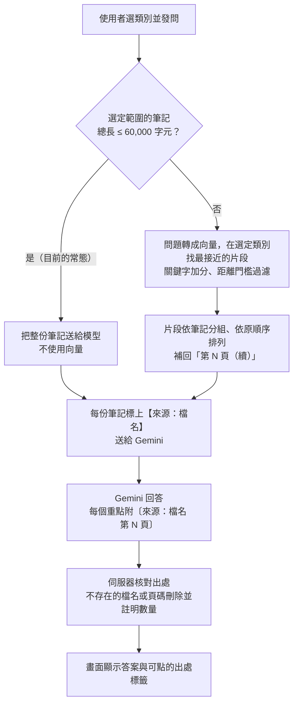

# NoteHandler 專題總覽

> 2026-09-21。合併原本的 `ROADMAP.md`、`PROGRESS.md`、`PROJECT_OVERVIEW.md`、`專題介紹.md`、`QA_結構與向量化.md`，是專案唯一的總文件。
> 完整實驗設計在 [實驗架構.md](實驗架構.md)；文獻與研究方向在 [文獻整理.md](文獻整理.md)。
>
> **讀者：** 組員、指導老師、接手的 AI 模型。第一部分可直接拿來對外介紹；第二到第四部分是研究與進度；第五部分是技術細節與工作規則。
> 程式會改、文件會舊：行動前以程式碼為準。

### 狀態標記

| 標記 | 意思 |
|---|---|
| ✅ | 已完成並上線 |
| ◐ | 做了一部分 |
| ⬜ | 尚未開始 |
| ✖ | 已取消 |
| ⏸ | 暫停（設計保留） |

### 目錄

- 第一部分　專題介紹
  1. 一句話介紹
  2. 要解決的問題
  3. 使用流程
  4. 系統架構
  5. 資料流程與向量化
  6. 設計原則
  7. 常見問題
  8. 名詞解釋
- 第二部分　研究
  9. 研究主張與假設
  10. 決定方向的事
  11. 研究線
- 第三部分　進度
  12. 現況
  13. 已完成的功能
- 第四部分　接下來
  14. 接下來的方向
  15. 建議順序
  16. 暫停或取消
  17. 零碎待辦
  18. 需要作者決定的事
- 第五部分　技術參考與工作規則
  19. 必須遵守的規則
  20. 檔案與位置
  21. 請求流程
  22. 檢索參數（勿隨意更改）
  23. 模型選擇
  24. 前端
  25. 設定
  26. 測試
  27. 歷史
  28. 評估過的外部資料
  29. 作者的工作習慣
  30. 相關檔案

---

# 第一部分　專題介紹

## 1. 一句話介紹

**NoteHandler 讓學生上傳自己的手寫筆記（照片、PDF、文字），分科目整理後直接發問，並且只根據自己的筆記回答，每個重點都附上可以點回原稿那一頁的出處。**

- 線上版：https://timhelloyee-notehandler.hf.space （請在新分頁開啟，Google 登入無法在 HF 內嵌框架中完成）
- 程式碼：https://github.com/timhelloyee/NoteHandlerRAG

## 2. 要解決的問題

| 問題 | 一般做法的缺點 | NoteHandler 的做法 |
|---|---|---|
| 手寫筆記無法搜尋 | 拍照後只是一堆圖片 | 用 Gemini 把筆記轉成文字，公式用 LaTeX、表格逐列、PDF 標頁碼 |
| 問一般 AI 會答出課本以外、甚至錯的內容 | 模型用自己的知識回答 | 只根據使用者自己的筆記回答；筆記裡沒有就明說「沒有記載」 |
| 不知道 AI 有沒有讀對字跡 | 看不到模型讀到了什麼 | 原稿與辨識文字並排，可以直接修正（產品功能；研究不依賴它，見第 9 節） |
| 不知道答案從哪來 | 答案無法追溯 | 每個重點附〔來源：檔名 第 N 頁〕，點下去跳到原稿該頁；伺服器會刪掉捏造的出處 |
| 各科筆記混在一起 | 問數學卻找到國文 | 使用者自訂類別，發問時選定類別就只看該類別 |
| 箭頭、圖解讀不出來 | 只剩模型排成一行行文字的樣子 | **研究中**：把箭頭與圖解轉成結構化資料（第 14 節 I5） |

**專題目標：** 讓使用者用 NoteHandler 做出以科目別的筆記整理與查詢；判準是模型的輸出能不能讓使用者看懂、並確認自己筆記的內容。檢索排名等數值只是手段，不是目標。

## 3. 使用流程

1. 用 Google 帳號登入。
2. 建立類別（例如：數學、地理），可新增、改名、刪除。
3. 上傳筆記並選擇類別；也可以之後把筆記拖曳到其他類別（手機用「移到」選單）。
4. 按「編輯」檢查辨識結果：左邊原稿、右邊辨識文字，PDF 可以依頁碼跳轉，改完儲存。
5. 選擇發問範圍（某個類別或全部類別），輸入問題。
6. 閱讀答案：數學式正常排版，每個重點後面有出處標籤，點下去會開啟原稿並跳到該頁。
7. 需要時把筆記存成 `.md` 匯出。

## 4. 系統架構



| 部分 | 使用的技術 |
|---|---|
| 前端 | 單一靜態 HTML 頁面（`app/static/index.html`，另有 `docs/index.html` 副本給 GitHub Pages），Markdown 與 LaTeX 排版 |
| 後端 | Python FastAPI（`app/main.py`）＋核心邏輯（`app/rag_core.py`） |
| 部署 | Hugging Face Space（Docker，port 7860），GitHub 同步保存程式碼 |
| 辨識與回答 | Google Gemini，預設 `gemini-3.1-flash-lite`，可選 8 個模型；兩把金鑰，額度用完或暫時無法使用時自動切換 |
| 嵌入模型 | `intfloat/multilingual-e5-base`，768 維，支援繁中與英文 |
| 向量庫 | ChromaDB，每位使用者、每個類別各一個資料夾，HNSW 索引、平方 L2 距離 |
| 資料保存 | Space 重啟會清空磁碟，所以筆記同步到私有 HF Dataset；筆記內容永遠不進 git |
| 登入 | 後端驗證 Google ID token，無法只憑 email 讀取他人筆記 |

## 5. 資料流程與向量化

### 5.1 上傳筆記



**辨識（Gemini）：**
- **圖片**（`describe_image`）：整張圖送給 Gemini。提示詞要求逐項寫出實際內容（定義、公式、例題條件，不要概括）、數學式用 LaTeX、不可編造、看不清處寫「（無法辨識）」、最後一行列出 5–10 個「關鍵字：」。
- **PDF**（`describe_pdf`）：用 pypdf 拆成單頁，4 頁並行辨識，表格逐列轉寫；空白頁跳過；組回時每頁前加 `## 第 N 頁`，頁碼因此保留在文字中。
- **文字筆記（txt、md）** 不經過辨識，依 `utf-8-sig`、`cp950`、`gb18030` 依序嘗試解碼（台灣的記事本常存成 Big5）。

| 辨識保留的 | 辨識沒保留的 |
|---|---|
| 頁碼、原文順序、公式、表格內容、關鍵用語 | 紙面上的空間位置：箭頭指向、左右分欄、框線圈起的關係，只剩 Gemini 排成一行行文字後的樣子 |

**切塊（`_chunk_text`）：** 一個向量要平均許多主題會稀釋細節，而且 e5 最多只讀 512 個 token，所以要切塊。

| 規則 | 值 |
|---|---|
| 每塊上限 | 450 字元 |
| 切點 | 盡量在句尾（`。！？；!?` 或換行） |
| 相鄰兩塊重疊 | 50 字元 |
| 避免碎片 | 最近的句尾會讓這塊短於 225 字元時，直接在 450 字元處切 |

**轉成向量（`embed_text`）：** `intfloat/multilingual-e5-base`，768 維；片段前加 `passage: `、問題前加 `query: `（e5 的訓練格式）；L2 正規化，比距離等於比 cosine 相似度。

**存入 Chroma：** 每個片段存 id（`檔名#0`、`檔名#1`…；只有一塊時就是檔名）、向量、原文、metadata（類型、第幾塊、共幾塊、關鍵字）。原檔另存 `originals/`。

### 5.2 發問



檢索路徑的細節（只有超過上限才會用到）：
- 每個選定類別各取最接近的 10 個片段；Chroma 距離 = 2 − 2·cos，越小越相似。
- **關鍵字加分：** 筆記關鍵字原封不動出現在問題中，每個讓距離減 0.03，最多 3 個；補足向量對專有名詞不敏感的缺點。
- **相關性門檻：** 最接近的片段距離仍大於 0.38 → 筆記裡沒有相關內容，只送一段，讓模型回答「沒有記載」。
- **保留數量：** 否則保留與最佳距離相差 0.10 以內的所有片段。
- **補回位置：** 片段依筆記分組、依原順序排列；不是該頁開頭的片段往前找頁碼，補上「第 N 頁（續）」。依原順序排列與 OP-RAG（NVIDIA, 2024）的關鍵做法一致。

**重點：結構和位置資訊存在「文字」和 metadata 裡，不存在向量裡。** 向量只負責「找」，找到後由程式把頁碼接回去；筆記量不大時連找都不用找，直接整份送給模型。

## 6. 設計原則：盡量減少讓 LLM 自己判斷（作者決定，2026-09-15）

LLM 只做兩件非它不可的事：**把手寫筆記轉成文字（含結構）**，以及**根據送進去的筆記回答問題**。其餘決定由使用者或可預測的程式規則做：

| 決定 | 由誰做 |
|---|---|
| 筆記放進哪個類別 | 使用者 |
| 問題在哪個範圍內找答案 | 使用者（「問題範圍」選單） |
| 出處是否有效 | 程式（比對送出的檔名與頁碼） |
| 整份送出或改走檢索 | 程式（固定字數上限） |
| 「筆記裡沒有」 | 程式（字串比對） |
| 多次辨識結果不一致時採用哪個 | 程式（逐字投票等固定規則，見 I3）；**不請 LLM 仲裁** |
| 結構輸出是否合法 | 程式（Mermaid 語法、連線是否指向存在的節點、座標是否在圖內；不合法就重新產生，見 I5） |
| 空白頁 | 應改為程式規則（目前依賴模型寫的科目，見第 17 節） |
| 評量打分 | 人工標註或程式計算，**不用 LLM 評審** |

新功能若需要 LLM 做分類、挑範圍、判斷自己有沒有把握之類的決定，預設不做；真的需要時先由作者同意。

**文獻依據**（詳見 `文獻整理.md` 第五節）：把 LLM 限縮在擅長的步驟、其餘交給固定程式準確度較高（*Less Is More*, GPCE 2026；PAL, ICML 2023）；LLM 自我修正與自我評估不可靠（Huang et al., ICLR 2024；Wang et al., 2023）；輸出越貼近原文幻覺越少、越容易驗證（*Copy-Paste*, ICLR 2026；*Extractive-Abstractive Spectrum*, 2024）。**不主張「AI 用得越少幻覺越少」**，精確說法是「可以用可驗證規則完成的步驟，就不要交給 LLM」。

## 7. 常見問題

**Q：這跟直接把筆記丟給 ChatGPT 或 NotebookLM 有什麼不同？**
筆記分類保存、可以反覆發問；回答只根據自己的筆記；每個出處都經過程式核對。NotebookLM 已經有手寫辨識、附出處、限定範圍、閃卡等功能，所以我們**不以功能區別**，而是以研究主張區別：在同一批手寫筆記上，不經修正的**回答**比它準，尤其是箭頭、圖解題（第 9 節）。

**Q：一般 RAG 把資料轉成向量會失去位置和結構，你們怎麼處理？**（指導老師的提問）
方向對，但做法不是去改向量：**結構和位置存在文字和 metadata 裡，不存在向量裡。**
1. 先轉成保留結構的文字：公式用 LaTeX、表格逐列、PDF 每頁加「第 N 頁」。
2. 向量只負責找；找到後送給模型的是原文字，附檔名與頁碼，模型每個重點都要標出處，伺服器核對。
3. 筆記總量 6 萬字元以內（一個學生一學期的筆記大多在此範圍）不走向量，整份送給模型，不會發生「向量化後丟失資訊」。
4. 「依標題階層切段、每段加標題路徑」的結構化切法試過，沒有明顯改善，而且實際使用幾乎走不到檢索，所以沒放進產品（第 11.1 節）。

目前研究的重點因此從「怎麼讓向量保留結構」轉為「**不經修正，就把手寫筆記的文字與箭頭、圖解讀對**」。

**Q：有什麼做不到的？**
紙面上的空間關係（箭頭、分欄、框線）目前只剩文字化後的樣子，這正是研究要解決的；字跡太潦草時會標「（無法辨識）」。

**Q：AI 會不會亂編出處？**
會發生，所以伺服器逐一核對：出處的檔名或頁碼不在這次送給模型的內容裡，就刪掉並在答案下方註明刪了幾個。已知缺口：只檢查出處存不存在，不檢查那一頁是否真的寫了這件事（第 13.4 節）。

**Q：資料安全嗎？**
筆記只存在私有的 HF Dataset，不進公開的程式碼庫；後端驗證 Google 登入，每位使用者只能存取自己的筆記。

## 8. 名詞解釋

| 名詞 | 意思 |
|---|---|
| RAG | 檢索增強生成：先找出相關資料，再讓模型根據這些資料回答 |
| 嵌入／向量 | 把一段文字轉成一串數字，意思相近的文字數字也相近，用來搜尋 |
| 切塊（chunk） | 把長筆記切成短片段，每段各轉成一個向量 |
| 整份送出模式 | 筆記夠少時不檢索，把全部筆記交給模型 |
| 出處（citation） | 答案中標出根據的是哪份筆記的第幾頁 |
| 字元錯誤率（CER） | 辨識稿和標準稿差了幾個字 ÷ 標準稿總字數，越低越好 |
| 節點／連線 F1 | 箭頭圖讀對了多少個方框與箭頭，越接近 1 越好 |
| 消融 | 一次加上或拿掉一個步驟，量出每個步驟各自的貢獻 |
| HF Space／Dataset | Hugging Face 提供的網站託管／資料託管服務 |
| MRR | 衡量正確答案平均排在第幾名的指標，越接近 1 越好 |

---

# 第二部分　研究

## 9. 研究主張與假設

### 9.1 主張（2026-09-21）

> **在不經使用者修正的情況下**，用專門工具拆解筆記、讓 LLM 只負責讀內容、再由程式驗證與比對，能讓手寫繁中筆記的**文字與結構（箭頭、圖解）辨識**更準確，並讓**根據這份辨識稿產生的答案**更正確、出處更正確；以現成 benchmark 的指標量測。**辨識層和自己的基準（整頁 Gemini）比；答案層再以 NotebookLM 為對照組。**

- **量的是自動輸出：** 所有研究量測都用系統直接產生、**未經人工修正**的辨識稿與答案。
- **使用者修正不是研究的一部分**（作者決定）：產品中的原稿並排與修正功能保留，但不作為研究主張或評量條件；「使用者能不能發現錯誤」的使用者實驗暫停（G4）。

### 9.2 假設

**一句話：題目主張「回答比 NotebookLM 準」，並用「辨識比直接讀準」證明原因。**

| 假設 | 比較對象 | 量什麼 | 角色 |
|---|---|---|---|
| **H1** 疊加前處理、版面切割與裁切、多次辨識投票、圖形轉 Mermaid 等步驟，能提升**辨識正確率** | 方法 3 vs 方法 2（同一個 Gemini 模型、同一版提示詞） | 字元錯誤率、箭頭與圖解的節點／連線 F1 | 機制 |
| **H2** 方法 3 的**回答正確率**高於 NotebookLM，尤其是箭頭、圖解題 | 方法 3 vs 方法 1（同一批筆記、同一組題目、同樣分科發問） | 答案、出處、拒答正確率，依題型分開 | **主要主張** |
| **H3** H2 的差距來自辨識 | 各方法答錯的題目 | 答錯原因中「讀錯字」「讀錯圖」的比例 | 連結 H1 與 H2 |

| 結果 | 解讀 |
|---|---|
| H1、H2 都成立 | 辨識變準，回答也比 NotebookLM 準 |
| H1 成立、H2 不成立 | 辨識變準但沒反映在回答上；檢查看圖題是否真的需要看圖 |
| H1 不成立、H2 成立 | 贏過 NotebookLM，但不是靠辨識步驟；用實驗 3（回答模式）、實驗 5（設計原則）找原因 |
| 都不成立 | 疊加步驟沒有幫助，誠實的負面結果 |

### 9.3 比較的方法

| # | 方法 | 內容 | 看得到辨識稿？ |
|---|---|---|---|
| 1 | **NotebookLM** | 上傳原圖，分科開 notebook 直接問 | **否** |
| 2 | **整頁直接讀**（NoteHandler 目前做法） | 整頁一次送 Gemini | 是 |
| 3a | 2 ＋ **I1 前處理** | OpenCV 拉正、透視校正、提高對比 | 是 |
| 3b | 3a ＋ **I2 版面切割與裁切放大** | PP-StructureV3 或 MinerU 切區塊，逐塊放大送 Gemini | 是 |
| 3c | 3b ＋ **I3 多次辨識投票** | Gemini（整區、放大重讀）與 PaddleOCR 各讀，程式逐字投票 | 是 |
| 3d | 3c ＋ **I5 圖形轉 Mermaid（TextFlow 式）** | 圖形區塊 → Gemini 輸出 Mermaid＋座標 → 程式驗證，不合法就重新產生 | 是 |
| （3e） | 3c ＋ **I5 Arrow-guided 式** | 先偵測箭頭起訖點與節點，連同座標交給 Gemini；**3d 夠好就不做**（手寫箭頭沒有現成偵測器） | 是 |

「方法 3」指序列的最後一步。3a → 3d 逐步疊加、每步量一次（消融）。

### 9.4 對照組的範圍：NotebookLM 只能比答案層

NotebookLM 的來源是唯讀的，目前查到的資料中沒有顯示辨識稿的介面（R0 時實際確認並記錄）。

| 指標層級 | 和 NotebookLM 比 | 辨識層的比較對象 |
|---|---|---|
| 辨識層（字元錯誤率、節點／連線 F1） | **不能** | 自己的消融序列：方法 2 → 3a → 3b → 3c → 3d |
| 答案層（正確率、幻覺、引用、拒答） | **可以** | NotebookLM、方法 2、方法 3 都比 |

- 新研究線的主軸「結構有沒有被正確讀出來」**沒有外部對照組**；辨識層的結論是「疊加步驟比直接讀準多少」，不是「比 NotebookLM 準」。
- 被問「你怎麼知道 NotebookLM 的字元錯誤率？」：**不知道，也沒有宣稱**。
- 「請 NotebookLM 逐字抄寫第 N 頁」算出的字元錯誤率只當參考：那是它回答時產生的文字，不一定是它內部用的辨識結果。

完整的變數、指標計算、統計與效度威脅見 [實驗架構.md](實驗架構.md)。

## 10. 決定方向的事

1. **專題目標的兩半都已可用。** 「整理」由分類系統完成，「可追溯」由答案出處完成。
2. **功能上無法和 NotebookLM 區別（2026-09-18 查證）。** 它已支援手寫圖片來源（App 內建相機）、附出處的回答、勾選資料範圍、閃卡與測驗，2026 年 4 月還加入自動分類。「支援手寫」「附出處」「可以分類」「繁體中文」都不能當區別。
3. **區別改為可驗證的主張**（第 9 節）：答案層贏 NotebookLM（H2），辨識層贏自己的基準（H1）。
4. **研究不與使用者修正掛鉤**（作者決定，2026-09-21）：務求在不修正的情況下提升正確率；程式發現問題時自動重讀或投票，不交給使用者。
5. **長上下文的文獻支持目前的整份送出設計，但上限不調高。** 資源足夠時長上下文平均勝過 RAG（Li et al., EMNLP 2024；LOFT；Li et al., 2025），但越長越容易漏看（Lost in the Middle；NoLiMa 顯示多數模型在 32K 左右明顯退步；*Context Length Alone Hurts*），在幻覺偵測任務上整份送入的幻覺反而較多（LaRA, ICML 2025）。維持 60,000 字元；不主張「整份送入會減少幻覺」。
6. **研究線從「結構幫不幫檢索」轉為「結構有沒有被正確讀出來」。** 指導老師提出「把結構轉成電腦能理解的資訊」「看得懂箭頭」。現成 benchmark（MindBench、FlowVQA、AI2D）都是印刷或合成的圖，**手寫、中文、筆記中的箭頭與圖解幾乎沒有人做**。
7. **不主張「解決幻覺」**，改為「量得出來」（G）與「在辨識階段就減少錯誤」（I1–I5）。
8. **注音辨識刪除**（作者決定，2026-09-21）：注音的使用者以國小生為主，與本專題客群不同。

## 11. 研究線

### 11.1 舊研究線：結構幫不幫檢索（✅ 已降為次要，負面結果）

最初的方向是「保留筆記結構能不能改善檢索」：依標題階層切段，每段前加標題路徑（例如「地理 › 氣候 › 季風成因 ›」）。程式已於 2026-09-21 刪除（git 歷史可找回），完整數據在 `eval/RESULTS_gating.txt`（不進 git）。數字以修正題組後為準（29 題、62 頁、float32）：

| 發現 | 證據 |
|---|---|
| 真實使用者幾乎不會走到檢索 | 60,000 字元以內整份送出；實驗語料 56,527 字元，必須強制 `WHOLE_CORPUS_CHARS=0` 才量得到檢索 |
| 保留結構測不出效果 | 結構切塊相對基準：e5 +0.001、Qwen3 +0.027；Holm 校正後無一成立 |
| 正對照沒有通過 | 刪除祖先路徑：e5 +0.052、Qwen3 −0.023，方向不一致 |
| 換嵌入模型是最大的槓桿 | e5 → Qwen3-0.6B，基準組 chunk MRR 0.799 → 0.871（差 +0.071，95% CI −0.017～+0.158），未達顯著 |
| 三個缺陷改變了結論 | 切塊器產生碎片（只影響人工校正組）、chunk 長度與切法混淆、6 題的答案寫在題目裡；修正後主要結論的正負號翻轉 |
| 可偵測的效果太大 | n=29 時約 +0.07～+0.13；29 題中 20 題原本就排第一（天花板效應） |

**`STRUCTURED_RULE`、`chunk_by_structure`、`merge_target` 在產品中從未啟用**（`add_image_note`、`add_pdf_note` 不傳 `structured=True`）。

### 11.2 新研究線：手寫筆記的結構忠實辨識與可驗證問答

| 問題 | 評分依據（現成指標） | 能和 NotebookLM 比？ |
|---|---|---|
| 手寫文字讀對多少？ | 字元錯誤率、編輯距離（OmniDocBench、OCRBench v2） | 否 |
| 箭頭、圖解讀對多少？ | 節點、連線 F1（MindBench） | 否 |
| 答案本身對不對？ | 對照標準答案人工判斷 | 是 |
| 答案有沒有幻覺？ | RAGTruth 的分類；RAGAS Faithfulness 的定義（改用人工標註） | 是 |
| 出處是否支持該句？ | ALCE 引用召回率、引用精確率 | 是 |
| 該拒答時有沒有拒答？ | 題組中筆記沒有答案的題目 | 是 |

---

# 第三部分　進度

## 12. 現況

### 12.1 部署與版本

| 項目 | 狀態 |
|---|---|
| HF Space（cpu-basic） | **`de70337`，RUNNING**；`/api/health` 為 `ok`；`/api/query` 回傳 `answer`、`model`、`sources`、`dropped` |
| GitHub `origin/main` | `de70337`（與 Space 相同） |
| 本機未部署的變更 | 模型清單加入 Gemini 3.8 Flash；`rag_core.py` 兩處說明文字；`eval/` 整理；`handoff/` 文件 |
| 真實帳號確認 | ✅ 作者已用 Google 帳號確認線上版 |
| 刪除類別的線上驗證 | ✅ 刪除後重啟 Space 不會復原 |
| Space `HF_TOKEN` | 有效 |
| 筆電推送 token | 存在 Git Credential Manager |

### 12.2 功能狀態

| 功能 | 狀態 | 說明 |
|---|---|---|
| 上傳文字、圖片、PDF | ✅ | PDF 逐頁平行辨識；上傳時可選「放入類別」 |
| 問答 | ✅ | 可指定類別；範圍在上限內整份送出，超過才檢索 |
| 答案出處 | ✅ | 可點的來源標籤，跳到原稿該頁；伺服器移除捏造的出處 |
| 模型選擇 | ✅ | 8 個 Gemini 模型（3.8 Flash 於 2026-09-21 加入，尚未部署） |
| 原稿與辨識文字並排修正 | ✅ | 目前以頁為單位對齊 |
| 完整內容與匯出 | ✅ | 「展開更多／顯示較少」、「儲存 .md」 |
| Google 登入由後端驗證 | ✅ | |
| 雲端同步狀態提示 | ✅ | |
| 分類系統 | ✅ | |
| UI 樣式編輯器 | ✅ | 只在本機開發模式啟用 |
| 命令列工具 | ✅ | `scripts/notehandler_input.py`、`scripts/notehandler_output.py` |
| 箭頭、圖解的結構化辨識 | ⬜ | I5 |
| 自動建議科目 | ✖ | 依設計原則取消 |

### 12.3 已知的辨識限制（研究要處理的）

- 紙面上的**空間關係**沒有被保留為結構，只剩 Gemini 線性化後的文字。
- 辨識**只讀一次、沒有任何自動檢查**：讀錯的字直接存進筆記庫，之後的答案會忠實地根據錯字回答。
- 辨識一次整頁送出，小字、上下標、小箭頭容易讀錯（*MLLMs Know Where to Look*, ICLR 2025：模型準確度對目標大小非常敏感）。

### 12.4 驗證

| 項目 | 結果 |
|---|---|
| `tests/test_auth_and_sync.py` | 18/18 |
| `tests/test_categories.py` | 12/12 |
| `tests/test_sources.py` | 8/8 |
| 本機分類實測 | A、B、C 三個 txt；拖曳往返；限定類別問答正確 |
| 本機出處實測（真實 Gemini） | 10 個出處全部有效；點「第 3 頁」正確跳頁 |
| 線上實測 | 未登入、只帶 email、偽造 Bearer、`X-Dev-User` 皆 401；同步 `ok` |
| Gemini 3.8 Flash（2026-09-21） | 兩把金鑰都可用，文字約 3 秒；看圖成功約 10 秒，但預設思考量大（輸出 52 token、思考 1,427 token），且高峰時段常回 503 |

## 13. 已完成的功能

### 13.1 讓使用者檢查模型讀到了什麼（`c6b14e2`）

| 項目 | 內容 | 位置 |
|---|---|---|
| 原稿／辨識文字並排 | 左邊原稿（圖片或 PDF），右邊可編輯文字；純文字筆記退回單欄；手機寬度堆疊 | `index.html` 的 `openEditor`、`originalPane` |
| 原稿內嵌顯示 | `/api/notes/{id}/original` 為 `inline`；`list_notes` 回傳 `has_original` | `main.py`、`rag_core.list_notes` |
| PDF 頁碼跳轉 | 解析 `## 第 N 頁` 產生頁碼按鈕，同時跳 PDF 與捲動文字；白頁閃爍已根治 | `pageJumper`、`framePdf` |
| 即時排版預覽 | 不需懂 LaTeX 也能改 | `renderRich` |
| 原稿快取 | `ETag`／`If-None-Match` 回 304 | `note_original` |
| 本機隔離開發伺服器 | 清空 `HF_TOKEN`、改用 `.devstore/` | `scripts/dev_server.py` |

### 13.2 信任與資料安全（`25fbb94`）

- **後端驗證身分：** 前端把 Google ID token 放進 `Authorization: Bearer`；`main.current_user` 用 `google-auth` 驗證簽章、`aud`、到期時間與 `email_verified`。所有端點都不接受 `user_id`。驗證結果快取到 token 到期；驗證失敗 401，連不到 Google 503。原稿以 token 抓取後用 `blob:` URL 顯示（``、`<iframe>` 無法帶標頭，且 email 或 token 放在網址裡會進伺服器紀錄）；`/original` 加 `Vary: Authorization, X-Dev-User`。本機開發以 `X-Dev-User` 代替 Google，偵測到 `SPACE_ID` 時拒絕啟用。
- **同步狀態：**

  | 狀態 | 條件 | 行為 |
  |---|---|---|
  | `ok` | 已從 Dataset 還原 | 無橫幅 |
  | `disabled` | 沒有 token，且不在 Space 上 | 灰色「本機模式」 |
  | `unavailable` | 還原失敗，或在 Space 上卻沒有 token | 紅色橫幅；所有寫入與問答一律 503 |
  | `unsaved` | 還原成功但之後某次同步失敗 | 黃色橫幅；下一次寫入即修復 |

- **原稿先存再同步：** `_add_described_note` 先存原稿再同步，失敗時刪掉原稿。
- **UI 樣式編輯器：** `/ui-editor`，17 個設計變數與 3 個字型位置，只改寫 `:root` 並同步到 `docs/`，值以白名單驗證，Space 上 404。

### 13.3 分類系統（`de82b07`）

- 新增、重新命名、刪除類別；⠿ 拖曳到其他類別，手機用「移到」選單；刪除類別時筆記移到「未分類」。
- 「問題範圍」選單：全部類別或某一類；「放入類別」選單：上傳時決定。
- 儲存方式：

  ```
  <VECTORSTORE_ROOT>/<使用者>/                     未分類
  <VECTORSTORE_ROOT>/<使用者>/categories/<id>/     一個類別
      category.json                                {"name": ..., "created": ...}
      chroma.sqlite3、<Chroma 索引資料夾>、originals/
  ```

- 每個類別是獨立資料夾，**無法建立子類別**；資料夾以固定 id 命名，改名只改 `category.json`；名稱 1–30 字、不分大小寫不可重複、「未分類／全部／全部類別」為保留名稱；筆記 id 在同一使用者的所有類別間唯一。

| 保證 | 做法 |
|---|---|
| 選了類別就只讀那個類別 | 只打開該資料夾 |
| 移動不重新嵌入、不呼叫 Gemini | 直接複製向量、文件、metadata 與原檔 |
| 刪掉的類別不會在重啟後回來 | `_persist_user` 以 `delete_patterns="*"` 讓 Dataset 鏡像使用者資料夾 |

### 13.4 答案附上出處（`794cb65`，部署於 `de70337`）

| 步驟 | 內容 |
|---|---|
| 標記送出的內容 | 每份筆記前加【來源：檔名】；PDF 保留「## 第 N 頁」；檢索片段補上「## 第 N 頁（續）」 |
| 要求模型標註 | `PROMPT_TEMPLATE` 第 5 條：每個重點標〔來源：檔名 第 N 頁〕 |
| 程式核對 | `_resolve_citations`：檔名不在送出的內容裡、或頁碼不存在，就從答案移除；限定類別時引用其他類別也無效 |
| API | `/api/query` 回傳 `sources: [{id, page, marker}]` 與 `dropped` |

**已知缺口：** 只檢查出處存不存在，不檢查那一頁是否真的寫了這件事。由 G1 以 ALCE 指標量測；若 G5 改用引用原句，程式可直接檢查引用文字是否出現在該頁。

### 13.5 工具與整理

- notebook 改成 `scripts/notehandler_input.py`、`scripts/notehandler_output.py`，呼叫 `app/rag_core.py`，預設用 `.devstore/`。
- 資料夾依用途整理：`app/`、`docs/`、`scripts/`、`tests/`、`eval/`、`handoff/`、`samples/`。
- 2026-09-21 整理 `eval/`：舊研究線程式、回歸測試、外部審查文件刪除（git 歷史可找回）；66 頁人工校正稿移到 `eval/g0/`，作為標準辨識稿。

---

# 第四部分　接下來

## 14. 接下來的方向

### 14.0 部署流程

1. 跑三個測試；確認 `docs/index.html` 與 `app/static/index.html` 一致。
2. 同時推 `origin main` 與 `hf main`；HF 由使用者在自己的終端機、NoteHandler 資料夾內推送。
3. Space 重建約 2–3 分鐘後檢查 `/api/health` 為 `ok`。若是 `unavailable`，修 Space secret，**不要改程式**。
4. 在獨立分頁（不是 HF 頁面裡的 iframe）用真實帳號登入確認。

### 14.1 產品

**E. 「筆記裡沒有」成為明確狀態**（⬜ 約半天）：以字串比對判斷拒答；API 回傳 `status`（`answered` / `not_in_notes`）；介面用不同樣式，建議改選其他類別。研究的正確拒答率也用它計算。

**C. 未選類別且超過上限時提示**（◐ 約半天）：選「全部類別」且超過 60,000 字元時，提示「這次只根據最相關的片段回答；選一個類別可以得到完整依據的回答」。不替使用者挑類別，上限不調高。

**D. 凸顯「（無法辨識）」**（⬜ 約半天，產品功能，**不屬於研究**）：編輯器以底色標出並提供「下一處」跳轉。

**辨識穩定性**（⬜）：高峰時段 Gemini 常回 503，目前只換一次金鑰就放棄；實驗需要「等待後重試」的機制。

### 14.2 研究：小實測（R，決定 I 做哪些）

| # | 實測 | 要回答的問題 | 影響 |
|---|---|---|---|
| R0 | 8 頁手寫筆記（`eval/r0/`）與 23 題，分科上傳 NotebookLM，NoteHandler 也跑一次 | 兩者不經修正的答案、出處、看圖題、拒答正確率（只有答案層）；NotebookLM 有沒有顯示辨識文字的介面 | 找出最弱題型；它全面都很準時區別需轉向 |
| R1 | 10 頁：Gemini vs PaddleOCR（PP-OCRv5） | PaddleOCR 讀繁中手寫的字元錯誤率 | 太差時 I3 誤報過多，改用其他引擎 |
| R2 | 同 10 頁：整頁送 vs 逐區塊裁切放大送 | 裁切是否降低字元錯誤率 | 有幫助才做 I2 |
| R3 | 有箭頭的頁：直接產生 Mermaid（3d）vs 先偵測箭頭（3e） | 手寫箭頭的節點、連線 F1 | 決定 I5 做法 |

### 14.3 研究＋產品：辨識改良（I）

**原則：** 先用專門工具拆解，再讓模型處理拆好的部分，最後用程式交叉檢查。LLM 只負責讀內容；程式發現問題時自動重讀或投票，不交給使用者。每一步能單獨開關。

```
手機照片
  → I1 前處理（拉正、提高對比）                   OpenCV，固定程式
  → I2 版面分析，切出文字區、公式區、圖形區         PP-StructureV3 或 MinerU
       每區裁切放大
       文字區：多次獨立辨識（Gemini、PaddleOCR）→ I3 程式逐字投票
       圖形區：Gemini 產生 Mermaid＋座標框 → I5 程式驗證，不合法就重新產生
  → I4 組回整頁辨識稿，每行帶座標框
  → 存入筆記庫，問答直接使用（不經人工修正）
```

| 項目 | 做法 | 狀態 |
|---|---|---|
| **I1 前處理** | 拉正歪斜、透視校正、提高對比；原稿保留未處理版本 | ⬜ 約半天 |
| **I2 版面分析與逐區塊辨識** | 切區塊、逐塊放大送 Gemini、依版面順序組回。代價：呼叫次數變多；PaddleOCR／MinerU 讓 Docker 映像變大，cpu-basic 要確認記憶體 | ⬜ 1–2 天，R2 有效才做 |
| **I3 多次辨識與程式投票** | 多份獨立辨識逐字對齊投票；仍不一致就只裁出那幾個字重讀；還是決定不了就用預先定好的規則並記錄。不請模型自評、不請 LLM 仲裁 | ⬜ 1–2 天，R1 可行才做 |
| **I4 逐行座標** | 每行附座標框（Gemini 支援，0–1000 比例座標）；讓 I3 能只裁出不一致的字重讀、出處細到行；座標由程式檢查 | ⬜ 1–2 天 |
| **I5 箭頭與圖解轉結構化資料**（**核心**） | 圖形區塊 → Mermaid＋節點座標 → 程式驗證（能否解析、連線指向的節點是否存在、座標在圖內、節點文字出現在文字辨識結果中）→ 失敗就把錯誤附在提示詞裡重新產生，最多固定次數，仍失敗退回純文字並記錄；問答時結構以文字整份送出。只輸出筆記上原有的結構，不讓模型重新組織 | ⬜ 2–3 天 |

I5 的依據：TextFlow（NAACL 2025）先轉 Mermaid 再推理，表現最好且錯誤可追溯；Arrow-Guided VLM（2025）先偵測箭頭，準確度 80% → 89%。兩者都是印刷流程圖，**手寫箭頭沒人測過**。

### 14.4 評量（G）

評分方法照既有論文，只自己準備小型測試資料；**不用 LLM 評審**，改用兩位標註者人工標註（計算 Cohen's κ）或程式計算。所有數字用未經修正的輸出。詳細設計、指標計算與統計見 [實驗架構.md](實驗架構.md)。

| 項目 | 內容 | 對應 | 狀態 |
|---|---|---|---|
| **G0 測試資料** | 已有 66 頁人工校正稿（`eval/g0/`，需去掉標題記號）；R0 的 8 頁手寫筆記（標準連線已寫在筆記稿中）；題組分單頁、跨頁、看圖、筆記沒有四類；全部不進 git | — | ◐ |
| **G1 系統層級評量與消融**（主要成果） | 辨識層：方法 2 → 3a → 3b → 3c → 3d 逐步量；答案層：方法 1、2、3 比較；另記答錯原因與複製程度 | 實驗 1、2 | ⬜ 3–5 天 |
| **G2 長上下文 vs 檢索** | 整份送入、切塊檢索、依原順序檢索 | 實驗 4 | ⬜ 約 1 天 |
| **G3 設計原則的消融** | 程式核對出處 vs LLM 判斷；使用者選類別 vs 全部類別 | 實驗 5 | ⬜ 約 1 天 |
| **G5 回答模式** | P0 目前提示詞（改寫）vs P1 CP-Link（只引用原句、可加短連接語，依 *Copy-Paste*, ICLR 2026）；P1 可讓程式直接驗證出處內容；代價是可讀性較低、錯字會被原封不動帶進答案；只改提示詞 | 實驗 3 | ⬜ 約 1 天 |
| G4 使用者實驗 | 人能不能發現錯誤（A 只有答案／B 加出處／C 完整 NoteHandler＋NotebookLM）；設計保留在 `文獻整理.md` 3.2 | — | ⏸ 暫停 |

### 14.5 延伸與低優先

| 項目 | 說明 | 狀態 |
|---|---|---|
| X2 租算力訓練小模型 | 瓶頸是資料不是算力；只針對 Gemini 確實失敗的窄任務（例如手寫箭頭偵測，LoRA 微調約 3B 視覺模型，需 24GB 以上顯卡）。參考 *Seeing is Believing?*（NeurIPS 2025） | ⬜ 視結果 |
| H 類別統整與複習 | 產生統整、小測驗；NotebookLM 已有閃卡與測驗，不構成區別 | ⬜ 降低優先 |
| F 替舊筆記補上原檔 | 又出現缺原檔、含手動修正的筆記時再做 | ⬜ 低優先 |

## 15. 建議順序

| 順序 | 項目 | 狀態 | 粗估 |
|---|---|---|---|
| 1 | 原稿並排、身分驗證、同步提示、分類系統、答案出處、工具整理 | ✅ | — |
| 2 | 文獻整理、研究主軸與假設、實驗架構 | ✅ 文件 | — |
| 3 | 手寫 R0 筆記 8 頁、選定實驗模型與思考設定 | ⬜ | 約 1 天 |
| 4 | **R0 基準**（NotebookLM 與目前的 NoteHandler） | ⬜ | 約 1 小時＋評分 |
| 5 | R1–R3 小實測 | ⬜ | 各約 1 小時 |
| 6 | E「筆記裡沒有」明確狀態；辨識的等待後重試 | ⬜ | 約半天 |
| 7 | I5 箭頭與圖解轉結構化資料 | ⬜ | 2–3 天 |
| 8 | I1–I3（依 R1、R2） | ⬜ | 3–4 天 |
| 9 | I4 逐行座標 | ⬜ | 1–2 天 |
| 10 | G1 系統層級評量與消融 | ⬜ | 3–5 天 |
| 11 | G2、G3、G5 次要實驗 | ⬜ | 2–3 天 |
| 12 | C 超過上限時提示、D 凸顯「（無法辨識）」 | ◐／⬜ | 各約半天 |
| — | G4 使用者實驗 | ⏸ | — |
| — | X2、H、F | ⬜ 視結果／低優先 | — |

## 16. 暫停或取消

| 項目 | 理由 |
|---|---|
| ✖ 自動建議科目、從問題自動判斷類別、自動把筆記移進類別 | 盡量減少讓 LLM 自己判斷 |
| ✖ 要模型自己標出「推測」內容 | LLM 自我評估不可靠（Huang et al., 2024） |
| ✖ 自動整理相關性與排版（設計 agent） | NotebookLM 已有；違反設計原則；難以客觀評分 |
| ✖ 以語言模型對齊（RLHF 等）為主題 | 學生專題無法訓練大模型；我們處理的是接地：答案對得上筆記、出處對得上原稿 |
| ✖ 主張「解決幻覺」「給越多資訊幻覺越少」 | 文獻不支持；改為量化＋在辨識階段減少錯誤 |
| ✖ 無限制調高整份送出上限 | 多數模型在 32K token 左右明顯退步（NoLiMa、RULER） |
| ✖ 用 LLM 當評審 | 位置偏誤（Wang et al., 2023；Judging the Judges, 2025），也違反設計原則 |
| ⏸ 以「使用者能發現並修正錯誤」為研究主張、G4 使用者實驗 | 研究先不與使用者修正掛鉤 |
| ✖ 辨識不一致時交給使用者確認、請 LLM 仲裁 | 改由 I3 程式投票 |
| ✖ 手寫注音辨識 | 客群不同（以國小生為主） |
| 結構保留作為**檢索**研究（B0、B4、M1–M3） | 優化使用者走不到的路徑，正對照沒有通過；版面分析改用在辨識（I2） |
| ColPali、contextual retrieval | 同上；4.3 GB 顯示卡跑不動 ColPali |
| 干擾頁實驗 | 作者決定：使用者不會刻意在筆記中加入無意義內容 |
| 現在就把線上嵌入模型換成 Qwen3 | 只影響檢索路徑；需重新嵌入所有筆記並重新校準門檻 |
| 用 PDF.js 取代內建 PDF 檢視器 | 試過，同樣會閃白；目前的做法已解決 |

## 17. 零碎待辦

- [ ] **空白頁改用程式規則判斷**：`is_blank_page` 目前要求模型寫的科目是「無法辨識」，而這不在 11 個科目選項裡；只寫姓名的頁面曾被標成「國文」沒被排除。
- [ ] **考慮從辨識提示詞拿掉科目判斷**：產品裡只剩空白頁判斷在用它；科目句會被存進筆記文字，並曾把生物筆記判成「無科目」。若 I2 改成逐區塊辨識，提示詞會重寫，可一併處理。
- [ ] 讀過主要引用論文的原文摘要與結論（至少：LaRA、Li et al. 2024、NoLiMa、Less Is More、Copy-Paste、Extractive-Abstractive Spectrum、TextFlow、Arrow-Guided VLM、MindBench、ALCE、RAGTruth）。
- [ ] 對外報告的研究數字統一口徑：第 11.1 節（0.799 → 0.871）與程式碼註解中的舊數字（0.813 → 0.897）不同。
- [ ] 編輯筆記時保留關鍵字（刪掉「關鍵字：」行會失去關鍵字加成）。
- [ ] `docs/index.html` 自動同步或加上檢查。
- [ ] 補測試：切塊不產生碎片、304 快取、樣式編輯器拒絕注入、`docs/` 一致。
- [ ] 刪除已併入 main 的分支 `claude/note-review-ui-and-eval-fixes`；確認 `claude/repository-overview-jHCkj` 是否還需要。
- [ ] 同步是整個使用者資料夾重新上傳，多人同時上傳可能互相覆蓋；一人使用沒問題。

## 18. 需要作者決定的事

| 事項 | 說明 |
|---|---|
| **實驗用的 Gemini 模型與思考設定** | 候選包括 3.8 Flash；開始前選定並記錄，全程不換（`實驗架構.md` 3.2） |
| 筆跡來源 | 目前筆記都來自同一人；建議請不同組員各寫一部分 |
| 公開 git 歷史中的筆記內容 | 已刪除的 notebook 從第一個 commit 起存著執行輸出（含公民、地理筆記），GitHub 與 HF 歷史仍查得到；徹底清除需改寫歷史並 force-push，**需要明確同意** |
| 輪替金鑰 | 曾貼在對話中的 HF／Gemini／LangChain 金鑰，以及舊 checkpoint 裡的 Gemini 金鑰。輪替 `HF_TOKEN` 時 Space secret 也要更新 |
| `ClaudeProjects\vectorstores\` | 9/14 錯誤啟動時從私有 Dataset 下載的筆記副本（在 repo 外），是否刪除 |
| 外部研究設計 | `研究流程 修改5.md` 的答案層設計是否併入 G；235 題題組不進公開 repo |
| 資源回收筒裡的 `.ipynb_checkpoints` | 其中兩份含舊的 Gemini 金鑰；確認不需要後清空 |
| 還原兩個檔案的要求 | 先前要求還原 `研究流程 修改5_審查回覆.md` 與一份記憶檔，該要求被中斷，兩個檔案仍保留；需要還原請再說一次 |
| GitHub Pages | 尚未啟用：Settings → Pages → `main` `/docs`，並把 `https://timhelloyee.github.io` 加入 Google OAuth 授權來源（CORS 已允許） |

---

# 第五部分　技術參考與工作規則

## 19. 必須遵守的規則

| 規則 | 原因 |
|---|---|
| 用 `C:/Users/user/anaconda3/envs/ragtraining/python.exe`，不要用裸 `python` | 裸 `python` 沒有 torch |
| 跑測試前設 `PYTHONIOENCODING=utf-8` | 預設 cp950 會在輸出中文時崩潰 |
| 改完 `app/static/index.html` 一定要複製到 `docs/index.html` | Pages 用的是手動副本，兩份必須 byte-identical |
| 部署時 GitHub（`origin`）和 HF Space（`hf`）都要推 | 兩個是獨立的 remote；忘了推 HF，線上版會默默落後 |
| **後端和前端必須一起部署** | 新後端會拒絕舊前端的請求，新前端也無法搭配舊後端 |
| HF 推送由使用者在**自己的終端機、NoteHandler 資料夾內**執行 `git push hf main:main` | 背景執行無法跳出 Git Credential Manager 登入視窗；使用者家目錄本身也是 git repo |
| 本機開發只用 `scripts/dev_server.py`，**不要**直接跑 `uvicorn app.main:app` | `.env` 含 `HF_TOKEN`，直接跑會還原並寫回真實的私有 Dataset |
| 本機伺服器啟動後先看 `/api/health`：必須是 `disabled` | `ok` 代表連到了真實 Dataset，立刻停掉 |
| 不要放寬 `unavailable` 狀態下的寫入封鎖 | 同步會讓 Dataset 鏡像本機資料夾，筆記庫沒載入時寫入會刪掉雲端上的真實筆記 |
| **盡量減少讓 LLM 自己判斷** | 作者決定（第 6 節） |
| 兩個 HF token 分開：Space secret 要能寫 **Dataset**；筆電 push token 只給 **Space** | 筆電 token 外洩時，不應連帶讓人能改寫筆記 |
| 絕不要求、顯示 token 值，也不要把 token 放進指令或 remote URL | 會留在 shell 歷史與 git 設定中 |
| **GitHub repo 與 HF Space 都是公開的** | 推到 `main` 的任何檔案都會公開 |
| 絕不把筆記內容、`vectorstores/`、`pdf/`、`.devstore/`、`eval/g0/`、`eval/r0/題組與標準答案.md`、掃描檔、標準辨識稿、結構標註放進 git | 筆記是使用者的私人資料 |
| 量測用 Qwen3 時必須 `EMBED_DTYPE=float32` | fp16 下重跑結果不一致 |
| force-push 需要使用者明確同意 | 曾為清除個資而改寫過歷史 |
| 引用文獻前要讀過原文摘要與結論 | `文獻整理.md` 的摘要取自搜尋結果 |
| `requirements.txt` 的版本上限不要隨意放寬（例如 `chromadb>=1.5,<2`） | Space 重建時大版本升級可能讓已存的筆記庫無法讀取 |

## 20. 檔案與位置

| 項目 | 位置 |
|---|---|
| 工作目錄 | `C:\Users\user\Desktop\ClaudeProjects\NoteHandler`（約 2026-08 從 `Desktop\PythonProjects` 搬來） |
| GitHub | `github.com/timhelloyee/NoteHandlerRAG`（remote `origin`，公開） |
| HF Space | `huggingface.co/spaces/timhelloyee/NoteHandler`（remote `hf`，Docker，port 7860，公開） |
| 筆記資料 | 私有 HF Dataset `timhelloyee/notehandler-store`，**永遠不進 git** |
| Python 環境 | `C:/Users/user/anaconda3/envs/ragtraining/python.exe`（本機有 torch＋CUDA；Space 只有 CPU） |

**資料保存模型（最重要）：** Space 的磁碟重啟就清空，所以 Docker 映像裡不放任何筆記、git 也不放。啟動時 `_restore_from_dataset()` 從私有 Dataset 下載整個 `vectorstores/`；每次新增、刪除後 `_persist_user()` 重新上傳該使用者的資料夾。Space 的 `HF_TOKEN` 失效時，後端進入 `unavailable` 並拒絕所有寫入與問答。這個設計是刻意的：`vectorstores/<使用者>` 以 email 命名、SQLite 裡有筆記內容；它們曾被 commit，已用 `git filter-repo` 從歷史清除並 force-push。

## 21. 請求流程

**`POST /api/query`**
1. `resolve_model()` 以白名單檢查模型，不在清單就用預設。
2. 依選定類別取得筆記：總長在上限內整份送出，否則檢索（第 5.2 節）。
3. 填入 `PROMPT_TEMPLATE`：用 `.replace()` **不用** `str.format()`，因為模板裡有 LaTeX 範例的 `{}`。
4. `_llm_invoke()`，額度用完或暫時無法使用時換金鑰；兩把都失敗 → `ModelUnavailableError` → HTTP 503。
5. `_resolve_citations` 核對出處，回傳 `{answer, model, sources, dropped}`。

**`POST /api/upload`**（multipart：`file`、`model`、`category`）：文字檔解碼後切塊；圖片、PDF 先檢查類別存在再呼叫 Gemini，避免浪費額度；重複檢查同時看 `<id>` 與 `<id>#0`。

**其他端點：** `GET /api/models`（下拉選單的來源與預設）、`GET /api/notes`、`GET`／`PUT`／`DELETE /api/notes/{id}`、`POST /api/notes/{id}/move`、`GET /api/notes/{id}/original`、`GET`／`POST /api/categories`、`PUT`／`DELETE /api/categories/{id}`、`GET /api/health`、`GET /`；本機開發模式另有 `/ui-editor` 與 `/api/ui-tokens`。

**Chunk id 格式：** 只有一塊的筆記用原檔名（`a.txt`），多塊用 `<檔名>#0`、`#1`…；`_base_id()` 還原。切塊功能加入前存的筆記是整份一塊，`list_notes`、`delete_note` 兩種都能處理。

## 22. 檢索參數（勿隨意更改）

這些常數是**量測出來的**，更改前要重新量測：

```python
CHUNK_CHARS = 450 ; CHUNK_OVERLAP = 50
KEYWORD_BONUS = 0.03 ; KEYWORD_BONUS_CAP = 3
RELEVANCE_CEILING = 0.38      # 判斷整個問題是否離題
RELATIVE_MARGIN  = 0.10       # 決定保留幾個片段
WHOLE_CORPUS_CHARS = 60_000   # 整份送出的上限
```

- Chroma 回報的是正規化向量的平方 L2 距離，正好等於 `2 − 2·cos`（已實測確認）。
- 在真實筆記上：答案**有**在筆記裡時，最佳距離 0.20–0.36；主題**不在**筆記裡時 0.37 以上。e5 的相似度被壓縮（無關的繁中仍約 0.77 cosine），兩群只差約 0.02。
- **這些距離屬於嵌入模型，不屬於程式。** 換成 Qwen3-0.6B 時兩群變成 0.41–1.13 與 0.83–1.37，沿用 0.38 會拒答所有問題；各模型的值在 `rag_core._GATE_BY_MODEL`。換模型是**資料遷移**（向量維度不同，要重新嵌入所有筆記），`get_user_collection` 遇到維度不符會明確報錯。
- **不要重新引入這個 bug：** 原本用單一 `MAX_DISTANCE = 0.35` 過濾每個片段，但真正的答案落在 0.33–0.36，幾乎全被過濾，只剩最佳一個，系統退化成只取一個片段（「我的筆記涵蓋哪些科目？」只答出 4 科中的 1 科，調大 `top_k` 完全沒變化）。修正方式是把一個數字拆成兩個工作：`RELEVANCE_CEILING` 判斷整題是否離題，`RELATIVE_MARGIN` 決定保留幾個。

## 23. 模型選擇

`AVAILABLE_MODELS`（`app/rag_core.py`）的 id 都**以 `models.list()` 實際查證**：

`gemini-3.8-flash` · `gemini-3.7-flash` · `gemini-3.6-flash` · `gemini-3.5-flash` · `gemini-3.5-flash-lite` · `gemini-3.1-flash-lite`（預設）· `gemini-3-flash-preview` · `gemini-2.5-flash`

- **「Gemini 3 Flash」只有 `gemini-3-flash-preview`**，沒有 `gemini-3-flash`，不要「修正」它。
- `gemini-3.8-live` 系列只支援即時語音串流的 Live API，一般呼叫會被拒絕，不能用來辨識或回答。
- 下拉選單同時決定回答與辨識所用的模型。前端從 `/api/models` 取得清單，後端睡著時用 `index.html` 內的備用清單（兩處要一起改）；`resolve_model()` 在伺服器端驗證，未知的 id 會變成預設值。
- 熱門模型常回 **503「需求過高」**，這是 Google 端的暫時狀況，不是 bug。

## 24. 前端

- 單一頁面；`docs/index.html` 是手動副本，改完要複製。
- **Google 登入無法在 HF Spaces 的內嵌框架中完成**（瀏覽器擋掉跨來源框架的 FedCM），Space 必須在獨立分頁開啟，這不是我們能修的。
- OAuth Client ID 是公開的，寫在原始碼裡（安全）；新的網址來源要加到 Google Cloud Console，否則出現 `origin_mismatch`。
- 排版：`renderRich()` 用於答案（完整 Markdown＋MathJax），`renderInline()` 用於預覽；LaTeX 先暫存再交給 `marked`，避免 `$m_1$` 的底線被誤判；DOMPurify 清理 HTML。
- `localStorage`：`nh_model`（選的模型）、`nh_ask_category`（問題範圍）、`nh_dev_user`（本機開發身分）。

## 25. 設定

本機用 `.env`（不進 git，範本 `.env.example`）；Space 用 Settings → Secrets。

| 變數 | 必要 | 用途 |
|---|---|---|
| `GEMINI_API_KEY_PRIMARY`、`GEMINI_API_KEY_SECONDARY` | 是 | 兩把金鑰，自動切換 |
| `HF_TOKEN` | Space 上是 | 讀寫私有 Dataset；缺少時 Space 進入 `unavailable` |
| `VECTORSTORE_DATASET` | 否 | 預設 `timhelloyee/notehandler-store` |
| `VECTORSTORE_ROOT` | 否 | 預設 `./vectorstores`；`dev_server.py` 改用 `.devstore` |
| `ALLOWED_ORIGINS` | 否 | CORS；預設含 `https://timhelloyee.github.io` |
| `GEMINI_MODEL` | 否 | 覆寫預設模型 |
| `WHOLE_CORPUS_CHARS` | 否 | 整份送出上限；設 0 強制檢索（實驗用） |
| `EMBED_MODEL`、`EMBED_DTYPE` | 否 | 換嵌入模型（需重新嵌入）；量測時用 `float32` |

## 26. 測試

`tests/` 下三個獨立腳本（直接用 Python 執行，不需真實帳號）：

| 檔案 | 內容 | 結果 |
|---|---|---|
| `tests/test_auth_and_sync.py` | 身分驗證（含偽造 token 被真正的 Google 驗證器拒絕）、每個端點都要登入、同步狀態 | 18/18 |
| `tests/test_categories.py` | 分類系統 | 12/12 |
| `tests/test_sources.py` | 出處核對（用假回覆測試有效出處、捏造頁碼與檔名、寫法變體、跨類別引用、拒答） | 8/8 |

寫臨時測試腳本的經驗：在 import `app.main` **之前**設 `os.environ["HF_TOKEN"] = ""`，並把工作目錄切到專案根目錄；`load_dotenv()` 在以管線輸入的腳本中有時會失敗，改寫成檔案再執行。

## 27. 歷史

| 時間 | 事件 |
|---|---|
| 早期 | Jupyter notebook＋CLIP 嵌入 → 改用 e5-base（CLIP 對中文弱、只讀 77 個 token），重構成 `app/`（FastAPI＋靜態頁） |
| 2026-08 | Google 登入；部署到 HF Spaces 與 GitHub；**隱私修正**：曾 commit 的向量庫（含 email 與筆記內容）從歷史清除，改用私有 Dataset；格式清理；切塊與關鍵字；模型選單；檢索過濾 bug 修正（第 22 節） |
| 2026-08-31～09-07 | 結構保留的檢索研究；發現三個缺陷、修正後無效果，研究線降為次要 |
| 2026-09-07 | 原稿並排修正（`c6b14e2`） |
| 2026-09-14 | 後端驗證登入、同步狀態（`25fbb94`）；分類系統（`de82b07`）；notebook 改成腳本 |
| 2026-09-15 | 答案出處（`794cb65`）；資料夾整理；部署 `de70337`；設計原則「盡量減少 LLM 判斷」 |
| 2026-09-17～21 | 與指導老師討論、文獻整理；研究主軸改為手寫筆記的結構忠實辨識；H1–H3；NotebookLM 只比答案層；研究不與使用者修正掛鉤；刪除注音研究；`eval/` 整理；加入 Gemini 3.8 Flash；R0 筆記與題組；實驗架構 |

## 28. 評估過的外部資料（沒有新證據不要重新爭論）

| 來源 | 結論 |
|---|---|
| 科展論文「結合 LSH 及知識圖譜改善 RAG」 | **採用**切塊與 LLM 關鍵字；**不採用** LSH（Chroma 已用更好的 HNSW）與知識圖譜（約 10 倍 token 成本；論文指標由 LLM 評、n=10） |
| iThome 介紹 Microsoft GraphRAG | 診斷正確（只取前幾個片段答不了整體性問題，這裡也驗證過），但規模不對：筆記量小到可以整份送出，勝過任何摘要階層。追查它時發現了真正的原因：檢索過濾 bug |
| 研究 HNSW 插入劣化、刪除墓碑、過濾式近似搜尋的建議 | 是正當的研究題目，但不是 app 的改良：1 萬 × 768 向量暴力搜尋只要 1.3 ms，相較 Gemini 的 1–5 秒可忽略 |
| NotebookLM（2026-09-18） | 功能上已涵蓋手寫、出處、範圍、閃卡、自動分類；區別只能靠研究主張 |
| 長上下文 vs RAG、LLM 參與與幻覺、辨識工具等文獻 | 見 `文獻整理.md` |

**一再出現的經驗：** 每個問題都是靠**量測**而不是推理解決的。模型 id 用 `models.list()` 查證；距離公式實測為 `2−2cos`；過濾 bug 是因為注意到 `top_k` 完全沒有影響而發現的。

## 29. 作者的工作習慣

- **先量測再下結論。** 作者曾糾正過錯誤假設（例如 `gemini-3.1-flash-lite` 曾被當成打錯字，其實存在）。
- 作者說暫停時不要自行推送；會說「continue」再繼續。
- 作者會用截圖精確回報畫面問題，預期會有多次 UI 調整。
- 重視自己資料的隱私（這促成了歷史清除）。
- 對話用繁體中文；UI 字串與提示詞保持**繁體中文**。
- 部署＝**兩個 remote**。

## 30. 相關檔案

| 檔案 | 內容 |
|---|---|
| `handoff/專題總覽.md` | 本文件 |
| `handoff/實驗架構.md` | 完整實驗設計：假設、方法、變數、資料、指標計算、流程、統計、效度威脅 |
| `handoff/文獻整理.md` | NotebookLM 比較、現成 benchmark、長上下文 vs RAG、LLM 參與與幻覺、辨識工具、可行性分析、參考文獻 |
| `eval/README.md` | `eval/` 各檔案的用途與是否進 git |
| `eval/r0/` | R0 手寫筆記稿（進 git）、題組與標準答案（不進 git） |
| `eval/g0/` | 66 頁人工校正辨識稿與整頁辨識基準（不進 git） |
| `eval/RESULTS_gating.txt` | 舊研究線的完整數據（不進 git，程式已刪除） |
| `tests/` | 三個測試腳本 |
| `scripts/dev_server.py` | 隔離的本機開發伺服器 |
| `scripts/notehandler_input.py`、`scripts/notehandler_output.py` | 命令列新增、刪除、列出、問答 |
| `.claude/launch.json` | Browser pane 啟動設定（使用 `scripts/dev_server.py`） |
